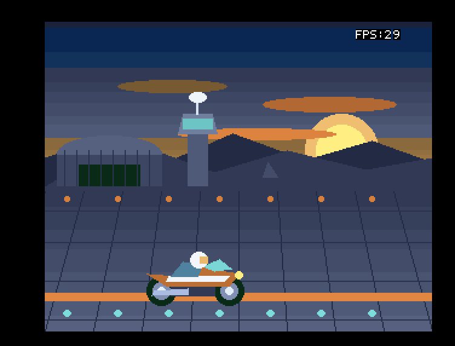
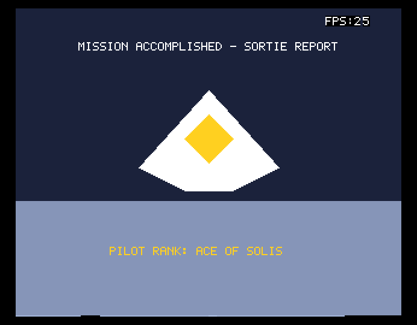
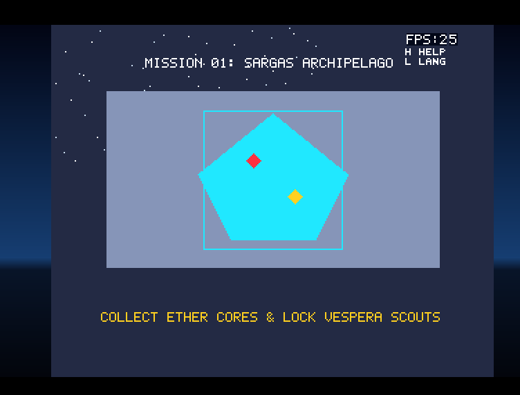
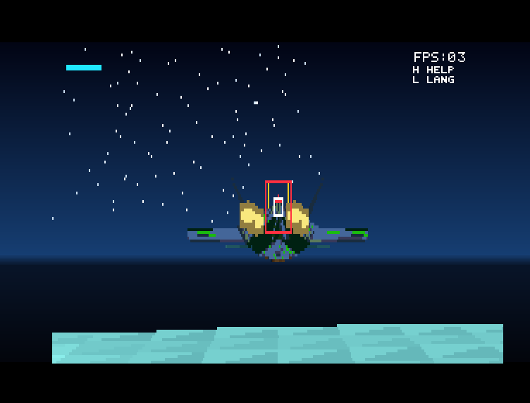

<strong>Polski</strong> | <a href="CHANGELOG_EN.md">English</a> | <a href="README.md">README</a>

# Changelog — AETHER FALCON: VANGUARD

Wszystkie istotne zmiany w projekcie **AETHER FALCON: VANGUARD** są dokumentowane w tym pliku.

---

## [v0.0.5] - 2026-11-25

|  |  |  |  |
|:---:|:---:|:---:|:---:|
| **1. Intro: Motocykl & Pilot** | **2. Briefing & Klawisze** | **3. Lot 3D & Działka** | **4. Raport Końcowy (Debriefing)** |

- **Wieloaktowe Intro Top Gun (`src/af_vector_scenes.i`):** sekwencja dojazdu motocykla pod hangar Solis, podejścia pilota do kokpitu XF-14, startu z dopalaczem oraz pojawienia się logo i tytułu gry na tle lecącego w dal myśliwca.
- **Podwójne wiązki działek plazmowych (`src/af_gameplay_3d.i`, `input_ctrl.i`):** natychmiastowy ostrzał działkami pod `Spacja / Fire / Alt / Enter` + salwy rakiet Multi-Lock.
- **Klawiszologia na Briefingu i pod `H` wyłącznie w grze (`src/af_campaigns.i`, `hud_fps.i`):** czysty licznik `FPS` w Intro/Briefingu/Debriefingu oraz dedykowana tabela sterowania gry.

---

## [v0.0.4] - 2026-11-25

- **Plynna fizyka lotu i ograniczniki sterow (`src/aether_falcon.s`):** dodano progresywne tlumienie przechylow (`Roll`) oraz twarde ograniczniki pochylenia (`Pitch` `-110..+110`), eliminujace wyjscie kamery poza korytarz kanionu.
- **Dynamiczna kamera dopalacza i animacja aerodynamiczna XF-14 (`src/af_gameplay_3d.i`):** odrzut kamery przy wlaczeniu dopalacza (`cam_oz = -168`) oraz subtelne mikrokolebanie kadluba w strugach powietrza.
- **Wersja THEA1200 16:9 Widescreen (`320x256` PAL):** pelnoekranowa korekcja proporcji anamorficznych `3/4` oraz pelne 256-liniowe przycinanie terenu 3D (`#520`).

---

## [v0.0.3] - 2026-11-25

- **Obsluga dysku twardego (`src/af_disk_loader.i` - `dos.library`):** wczytywanie z katalogu `data/` parametrow kampanii (`missions.dat`), rekordu punktow (`hiscore.dat` z automatycznym zapisem przy wyjsciu), ekranu AGA (`title.chk` + `title.pal`) oraz sampla PCM dla Pauli (`intro.pcm`), automatycznie pakowanych do `.lha` i `_FSUAE.zip`.
- **Silnik scen wektorowych N-gon w stylu *Another World* (`src/af_vector_scenes.i`):** niezalezna paleta fabularna AGA i tla, szybki rasteryzer wielokatow N-gon (`16.16` fixed-point + zapisy 32-bitowe `move.l`), animowany start **XF-14 Albatros** z lotniskowca *Solis* oraz reakcyjny *Briefing* i *Debriefing*.
- **Boss Misji 03 (*Latajaca Forteca Lewiatan*) i eksplozje czasteczkowe 3D:** cytadela na koncu Misji 03 z **4 niezaleznymi reaktorami** *Multi-Lock*, rozbryzg 3D odlamkow z efektem wybuchu na kanale 3 ukladu Paula oraz pelna petla kampanii (`Misje 01 -> 02 -> 03 -> Final`).
- **Optymalizacja FPS pod bazowa Amige 1200 (`68EC020` 14 MHz):** redukcja siatki terenu z `16x13` do `12x10` z szybkim wypelnianiem 32-bitowym bez narzutu Z-buffera, selektywne czyszczenie `zbuf_3d` wylacznie pod mysliwcem XF-14 oraz pelna kalibracja celownika i HUD w trybie `320x128`.

<table><tr><td align="center"> <b>Intro: Lotniskowiec Solis (v0.0.3)</b></td><td align="center"> <b>Briefing: Mapa N-gon (v0.0.3)</b></td><td align="center"> <b>Lot 3D &amp; Kanion 12x10 (v0.0.3)</b></td></tr></table>

---

## [v0.0.2] - 2026-11-25

- **Ujednolicony potok 256-kolorowy AGA (`Intro -> Briefing -> 3D Gameplay -> Debriefing`):** przeniesiono renderowanie ekranów wektorowych i odpraw misji do wspólnego bufora `chunky_buf` + C2P AGA z kontrastową paletą HUD (`$FC..$FF`).
- **Poprawka czcionki bitmapowej `5×7` i prymitywów HUD:** naprawiono 8-bajtowy krok znaków `hud_ascii_5x7` (bity `4..0`), wdrożono pełne 4-boczne ramki celownika **Lock-On** oraz wypełnione romby emblemu Konfederacji Solis.
- **Pozycja myśliwca XF-14 „Albatros” i sterowanie klawiaturą:** wyniesiono sylwetkę myśliwca wyraźnie ponad przewijany teren 3D (`Y=12`, `Z=22`), dodano pełne sterowanie lotem i celownikiem z klawiatury (`Strzałki + Spacja`) obok portu Joysticka 2 oraz flagę `-DM68060` dla profilu `060`.
- **Utwardzenie alokacji Chip/Fast RAM i wektora VBR:** przeniesiono bitplany AGA (`180 KB MEMF_CHIP`) oraz tablicę `fill_lut` (`512 KB MEMF_FAST`) do dynamicznej alokacji `Exec AllocMem`, dodano odczyt rejestru `VBR` przez `Exec Supervisor()` dla przerwania 50 Hz VBL oraz cache palety na ekranach menu.

<table><tr><td align="center"> <b>Ekran Tytulowy (v0.0.2)</b></td><td align="center"> <b>Briefing (v0.0.2)</b></td><td align="center"> <b>Lot 3D XF-14 (v0.0.2)</b></td></tr></table>

---

## [v0.0.1] - 2026-11-25

- **Pierwsze wydanie szkieletu gry (Bare-Metal M68k):** implementacja maszyny stanów kampanii (`Intro -> Briefing -> Gameplay -> Debriefing`) oraz 3 misji (*Sargas Archipelago*, *Krell Storm Canyon*, *Leviathan Citadel*).
- **Autorski model 3D myśliwca XF-14 „Albatros”:** proceduralnie wygenerowana siatka 3D (`29` wierzchołków, `38` trójkątów wielomateriałowych z normalnymi do cieniowania Gouraud/Specular) oraz podwójna smuga spalin z dysz.
- **Mechanika rozgrywki i system Lock-On:** przelot nad terenem wysokościowym 3D, zbieranie Rdzeni Eteru, celownik 2D/3D z jednoczesnym namierzaniem do 8 celów i salwami samonaprowadzających rakiet.
- **Audio ProTracker `.MOD` + Paula SFX:** 4-kanałowy odtwarzacz muzyki połączony ze sprzętowym sterownikiem efektów dźwiękowych na kanale 3 układu Paula (`Lock-On`, salwa rakiet, zebranie Rdzenia Eteru).
- **System budowania 3 profili wydawniczych (`tools/build_game.py`):** automatyczna kompilacja paczek `.lha` (WHDLoad Slave v17 + ikonka `.info`) oraz `_FSUAE.zip` dla profili `standard` (`020`), `thea1200` (`FULL_RES`) i `060` (`MC68060`).
