## v0.2.0.6 (2026-11-28)

- **3 odrębne rozgrywki dla profesji (dyskowe wczytywanie fabuły i muzyki `.MOD` po wyborze klasy):**
  - **Pionier (`PIO`)** — najszybszy zwiadowca (`±4` skręt, `+1` ciąg); wyszukuje i skanuje wiązką `F / LMB` **8 formacji kryształów Aetheru**.
  - **Strażnik (`GRD`)** — katamaran bojowy (`±3` skręt); patroluje niebo i neutralizuje działkiem **8 wrogich dronów**.
  - **Inżynier (`ENG`)** — ciężka barka (`±2` skręt); fizycznie dokuje na lądowiskach (`THR 0..1`) lub używa wiązki konstrukcyjnej, odbudowując **8 baz kolonii** i wznosząc złote wieże przekaźnikowe w wokselach.
- **Przepustnica i sterowanie:** biegi ciągu `0..4` (`E` / `Q,Z,C`), zawis (`X`), osobny dopalacz (`Spacja / LAlt`), wskaźnik `THR` na HUD, spowolniona 4× skala prędkości przelotu oraz kursor strzałki sci-fi w menu.
- **Nawigacja open-world 360° i poprawki stabilności:** górny kompas `N/W/S/E`, współrzędne `S:XXX/YYY`, obrotowy radar 360° ze strzałką celu profesji, Dziennik Pokładowy z mapą terenu pod klawiszem `J`, 32-bitowe dzielenie ziarna `SEED` na MC68040 oraz pełny zapis 76 bajtów w `data/colony.sav`.

## v0.2.0.5 (2026-11-28)
- 100% wokselowe bazy kolonii (ladowiska, kopuly, wieze) i krysztaly Aetheru w terenie.
- Generator swiata z dowolnego 6-cyfrowego ziarna SEED bezposrednio w menu gry na MC68040.
- 3 profesje (Pionier, Straznik, Inzynier) z osobnymi portretami AGA, 3 statkami 3D, 3 sciezkami .MOD i fabulami doczytywanymi z dysku.
- Filmowy Prolog na tle przelotu 360 oraz rozszerzone efekty SFX na ukladzie Paula.

## v0.2.0.4 (2026-11-27)
- Generator otwartego świata (`SEED`), 8 baz, 8 kryształów anomalii, obrotowy radar 360° i mapa topograficzna pod `J`.
- Pełna dwujęzyczna kampania (`PL` z polskimi znakami i `EN`) ładowana z dysku twardego (`story_pl.bin` / `story_en.bin`), Prolog i Epilog Aktu III.
- 3 unikalne modele poduszkowców 3D dla klas (Pionier, Strażnik, Inżynier), 6 portretów postaci AGA oraz 4 ścieżki dźwiękowe ProTracker `.MOD`.

|  |  | 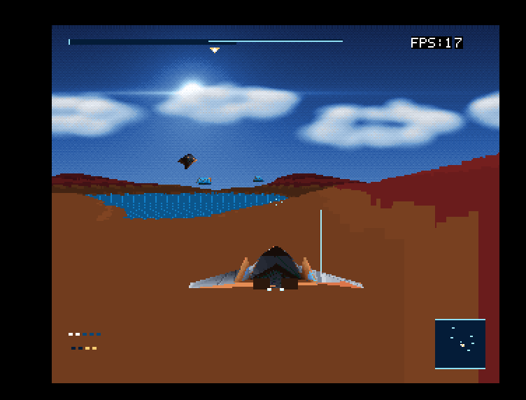 |
|:---:|:---:|:---:|
| **1. Poduszkowiec i kopuły 3D baz** | **2. Komunikacja z oficerem sektora** | **3. Dziennik i mapa topograficzna** |

# Changelog

## [v0.2.0.3] - 2026-11-27
### Naprawiono i zmieniono
* Naprawiono 8-bajtowy stride trójkątów w siatkach 3D (`exo_ship_hud.i`, `exo_world_objs.i`), usuwając rozjechanie bryły myśliwca i dronów po wcześniejszych zmianach.
* Skompensowano przesunięcie tablicy `sin_tab` (`192` = 0°) w `build_rot_matrix_3d`, przywracając symetryczny widok myśliwca od tyłu i z góry.
* Wyrównano wektor lotu i prędkość przelotu 360° w `flight_ctrl.i` oraz `exo_menu.i` (spójny lot w głąb terenu od pierwszej klatki menu i misji).
* Dodano dedykowany kontroler wejścia `src/game_input.i` (klawiatura CIA-A, joystick Port 2, mysz THEA1200) bez skrótów demowych AURA-3D.
* Zaktualizowano panoramiczne niebo 360° AGA (`data/exo_sky360.bin`) oraz portret oficera (`data/exo_portrait.bin`).

<strong>Polski</strong> | <a href="CHANGELOG_EN.md">English</a> | <a href="README.md">README</a>

# Changelog — AETHER FALCON: VANGUARD

Wszystkie istotne zmiany w projekcie **AETHER FALCON: VANGUARD** są dokumentowane w tym pliku.

---

## [v0.2.0.2] - 2026-11-27

|  |  |  |
|:---:|:---:|:---:|
| **1. Menu startowe z kinowym letterboxem** | **2. Okno dialogowe z animowanym portretem** | **3. Lot 360° z odbiciami wody i bryłami 3D** |

- **Zamrożenie warstwy silnikowej 68040 / THEA1200 (`0 błędów, 0 ostrzeżeń`):** wszystkie moduły silnika przetestowane w praktyce i zsynchronizowane w `src/` oraz `refs/aura3d/engine/`.
- **Odbicia na wodzie, cienie 3D na terenie i kontroler lotu (`terrain_3d.i`, `vec3d_engine.i`, `flight_ctrl.i`):** falujące odbicia nieba na tafli wody, rzutowanie cieni pod obiektami 3D na powierzchnię gór (`vx_ybuf`), płynne sterowanie 360° z przechyłem skrzydeł, pochyleniem horyzontu `cam_pitch` i ochroną przed kolizją z gruntem.
- **Silnik filmowy i obsługa myszy THEA1200 (`cinematic_fx.i`, `thea1200_hw.i`):** animowane pasy letterbox (wysuwanie i chowanie), okno dialogowe z portretem i efektem maszyny do pisania, 24-bitowy fader i oświetlenie nastroju AGA oraz pełna obsługa myszy (`$DFF00A` + LPM) w menu, dialogach i locie.
- **32-bitowy C2P 68040 (`c2p_chunky.i`):** aktywacja pełnego potoku 32-bitowego dla profilu `FULL_RES` (`320×256 AGA`).

---

## [v0.2.0.1] - 2026-11-27

- **Kamień Milowy Kompletnego Silnika 68040 / THEA1200 (`0 błędów, 0 ostrzeżeń`):** zamknięcie warstwy silnikowej z pełną synchronizacją modułów w `src/` oraz `refs/aura3d/engine/`.
- **Silnik Terenu Voxel Space 3D (`terrain_3d.i`):** przyrostowy raymarching 68040 (bez mnożeń `muls.w` w wewnętrznej pętli promienia), szybka tablica wierszy `vx_row_lut`, pochylenie horyzontu `cam_pitch`, bufor głębokości `vx_ybuf` (320 kolumn) oraz przemiana biosfery.
- **Silnik Obiektów 3D i Cząsteczek (`vec3d_engine.i`, `aura3d_v2.i`):** rzutowanie wielokątnych brył 3D z cieniowaniem Gouraud i czyszczeniem Z-bufora `movem.l` (32B/cykl), słońce 360° z poświatą atmosferyczną (*Corona*), warstwa chmur 360°, system 32 cząsteczek 3D oraz linie Bresenhama.
- **Silnik Filmowy, Narracyjny i Obsługa Sprzętu THEA1200 (`cinematic_fx.i`, `thea1200_hw.i`):** kinowe pasy letterbox, rasteryzer wielokątów 2D pod portrety i cutscenki, okno dialogowe z ramką portretu, płynny choreograf kamery, 24-bitowy fader palety AGA oraz jednoczesna obsługa klawiatury, myszy Amigi (`$DFF00A`) i gamepada wieloprzyciskowego (`$DFF016`).

---

## [v0.2.0.0] - 2026-11-26

|  | 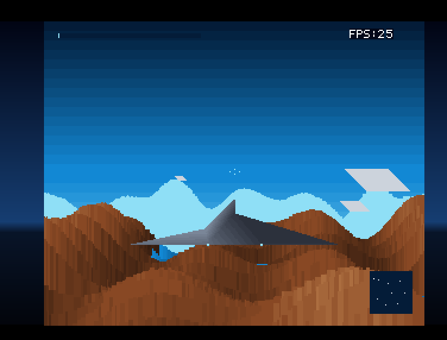 |
|:---:|:---:|
| **1. Menu startowe i wybór roli / zapisu** | **2. Lot 360° Voxel Space 3D i radar** |

- **Dedykowany silnik 68040 pod THEA1200 (`src/aether_falcon.s`, `tools/build_game.py`):** przełączenie kompilacji na `-m68040` w pełnej rozdzielczości `320×256 AGA` (256 kolorów) oraz synchronizacja nowych modułów z `refs/aura3d/engine/`.
- **Silnik terenu Voxel Space 3D 360° z buforem głębokości (`vx_ybuf`) i mgłą odległości (`Z-Fog`):** swobodny obrót 360° nad pasmami górskimi i jeziorami egzoplanety (`data/exo_voxel.bin`, `data/exo_pal256.bin`).
- **Szkielet rozgrywki, menu ról i zapis na dysk (`exo_menu.i`, `exo_world_objs.i`, `exo_save_load.i`, `exo_victory.i`):** wybór Nowej Kampanii (`1: PIONEER`, `2: GUARDIAN`, `3: ENGINEER`), wczytanie zapisanej kolonii (`4: LOAD SAVED COLONY`), auto-zapis i ręczny zapis (`S`) do `data/colony.sav`, radar `256×256`, licznik `FPS` oraz czysta ścieżka `.MOD` (`data/exo_theme.mod`) i efekty SFX (`exo_sound.i`).

---

## [v0.1.3] - 2026-11-25

| 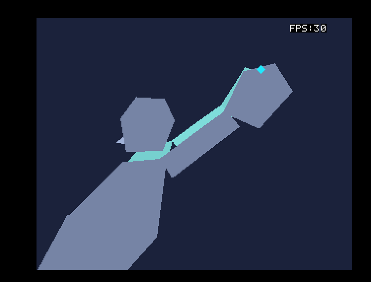 | 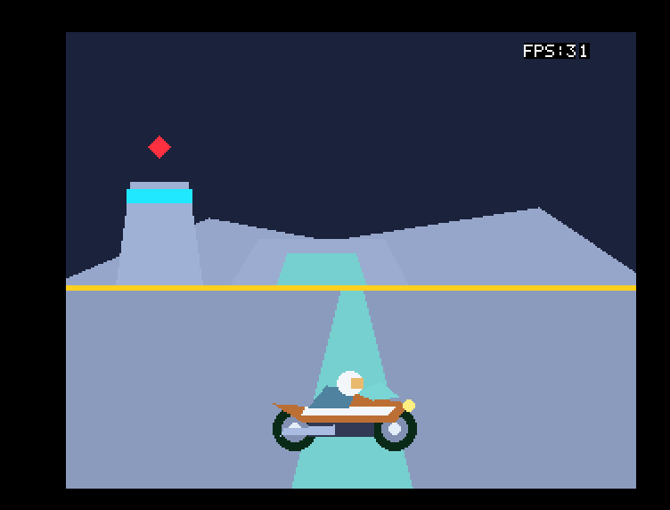 | 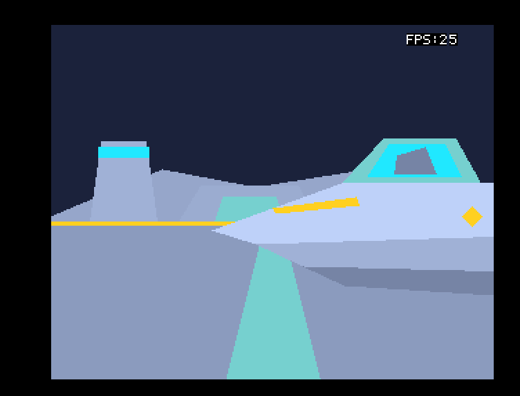 |
|:---:|:---:|:---:|
| **1. Akt I: Salute to the Sky** | **2. Akt II: Baza Solis** | **3. Akt III: Kokpit XF-14** |
|  |  |  |
|:---:|:---:|:---:|
| **4. Akt IV: Start 3D XF-14** | **5. Briefing: Dowódca** | **6. Debriefing: Portret Pilota** |

- **Boss Lewiatan i 4 Wirujace Reaktory w Misji 03 (`src/af_gameplay_3d.i`):** automatyczna aktywacja Latajacej Fortecy Lewiatan 3D oraz 4 niezaleznych reaktorow orbitalnych z celownikami po rozpoczeciu Misji 03 (*Leviathan Citadel*).
- **Pelna Spojnosc Stylistyczna Filmu *Eon* (TBL) (`src/af_vector_scenes.i`):** zastapienie bitmapowej scenerii lotniska w Aktach 2–4 jednolita, bezkonturowa architektura wielotonowych wielokatow w palecie *Eon* (`#16`, `#22..#24`, `#215`, `#253`, `#254`).

---

## [v0.1.2] - 2026-11-25

- **Pelne 5-Aktowe Filmy Rotoskopowe w Stylu *Eon* (TBL) (`src/af_vector_scenes.i`):** rozbudowane, wieloscenowe przerywniki filmowe na poczatek gry (**Intro** — 5 aktow: *Salute to the Sky*, alarm w bazie Solis, zblizenie na kokpit XF-14 z dopalaczami, start 3D w niebo oraz tytul), start kazdej misji (**Briefing** z animowanym portretem Dowodcy i hologramem) oraz zakonczenie misji (**Debriefing / Game Over** z animowanym portretem Pilota 3/4).

---

## [v0.1.1] - 2026-11-25

- **Wielotonowe Sceny Rotoskopowe w Stylu *Eon* (The Black Lotus) (`src/af_vector_scenes.i`, `src/af_campaigns.i`):** bezkonturowy odtwarzacz wielokatow `af_play_eon_scene` dla 3 scen fabularnych:
  - **Intro (Akt I — „Salute to the Sky”):** sylwetka pilota unoszacego zacisnieta piesc na tle srebrzystego nieba (`#30`) z chlodnym podswietleniem krawedziowym (`#215`/`#217`).
  - **Briefing („Commander’s Vigil”):** wielotonowy portret dowodcy eskadry Vanguard wspierajacego podbrodek na dloni obok tablicy odpraw.
  - **Debriefing / Game Over („Pilot’s Resolve”):** dramatyczny portret pilota 3/4 z bocznym oswietleniem na glebokiej czerni (`#16`).

---

## [v0.1.0] - 2026-11-25

| 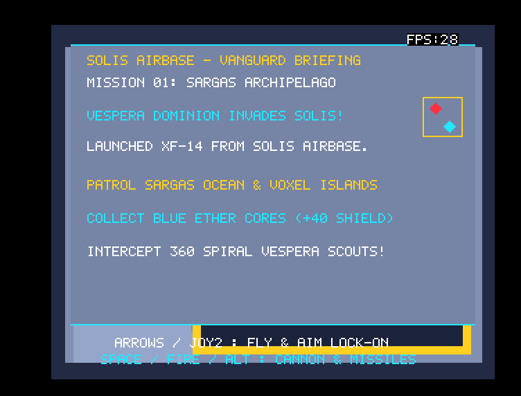 |  |
|:---:|:---:|
| **1. Tablica Odpraw Taktycznych (Briefing)** | **2. Chmury 3D, Woksele i Licznik SCORE** |

- **Wielowarstwowe Chmury 3D na Niebie (`af_draw_3d_clouds` w `src/af_voxel_world.i`):** 16 przestrzennych formacji chmur 3D z cieniowaniem wolumetrycznym i paralaksa, zmieniajacych klimat w zaleznosci od misji (cumulusy w Misji 01, chmury burzowe w Misji 02, obloki wulkaniczne w Misji 03).
- **Aktywacja efektow `AURA-3D` (`Z-Fog`, `Phong + Fresnel Rim Glow`, cien XF-14):** wlaczenie sprzetowej mgly glebi `zfog_enabled`, oswietlenia `phong_enabled` oraz dynamicznego cienia rzucanego pod mysliwcem XF-14 Albatros.

---

## [v0.0.9] - 2026-11-25

|  |  |  |
|:---:|:---:|:---:|
| **1. Wokselowy Ocean i Wyspy** | **2. Przelot 360° i Celownik 3D** | **3. Góry, Ląd i Modele 3D** |

- **Silnik Wokselowy 3D dla 3 Misji (`src/af_voxel_world.i`):** proceduralny raycaster Voxel Space 3D (160 podwojnych kolumn = 320 px AGA, Y-buffer horyzontu) generujacy ocean, wyspy i gory w Misji 01, gleboki kanion gorski z rzeka w Misji 02 oraz wulkaniczny lad z wiezami cytadeli w Misji 03.
- **Celownik 3D Lock-On i poprawka bliskiego planu (`src/af_gameplay_3d.i`):** przyklejenie ramki Lock-On do rzutowanej pozycji 3D dziobu wroga oraz klip bliskiego planu bryl 3D (`Z >= 180`).

---

## [v0.0.8] - 2026-11-25

- **Prawdziwe modele 3D Gouraud / EnvMap dla wrogow, Rdzeni Eteru i Bossa Lewiatana (`src/af_enemy_meshes.i`, `src/af_gameplay_3d.i`):** wygenerowano narzedziem silnika `refs/aura3d/tools/mesh_conv.py` wielobrylowe siatki 3D dla mysliwcow *Vespera Interceptor* (14 wierzcholkow, 24 trojkaty), wirujacych krysztalowych *Rdzeni Eteru* (6 wierzcholkow, 8 trojkatow) oraz *Cytadeli Lewiatan* w Misji 03 (16 wierzcholkow, 28 trojkatow + 4 wirujace reaktory 3D) z pelnoekranowym Z-bufferem (`320x256` / `320x128`).
- **Zarys fabuly i instrukcja obiektow 3D w dokumentacji (`README.md`, `README_EN.md`):** dodano opis kampanii 3 misji oraz tabele obiektow 3D (wrogie mysliwce, Rdzenie Eteru, pociski i Boss Lewiatan).

---

## [v0.0.7] - 2026-11-25

- **Sztywna orientacja 3D mysliwca XF-14 Albatros na pelnym okregu 360 st. (`src/af_gameplay_3d.i`, `src/aether_falcon.s`):** ortonormalna macierz transformacji typu *Gyruss / Tempest* utrzymujaca dziob zawsze w kierunku srodka ekranu, brzuch kadluba na zewnatrz ku krawedzi ekranu oraz skrzydla stycznie wzdluz okregu; klawisze Gora/Dol reguluja wylacznie promien lotu bez obracania kadlubem.
- **System uszkodzen tarczy i ekran Game Over / Debriefing (`src/af_gameplay_3d.i`, `src/af_campaigns.i`):** detekcja trafien 2D na calym okregu 360 st., dynamiczny kolor paska tarczy (blekit/zloto/czerwien), czerwona ramka alarmowa i ostrzezenia `SHIELD HIT!` / `CRITICAL SHIELD!`, a po spadku energii do zera ekran `GAME OVER - XF-14 DESTROYED` z mozliwoscia natychmiastowego restartu kampanii.
- **Nowe formacje 360 st. oraz walka z Bossem Lewiatanem w Misji 03 (`src/af_gameplay_3d.i`):** spiralne i helikalne formacje przeciwnikow na pelnym okregu 360 st. oraz cytadela Lewiatana w centrum tunelu z 4 wirujacymi po okregu 360 st. reaktorami i ostrzalem promieniowym.

---

## [v0.0.5] - 2026-11-25

|  | 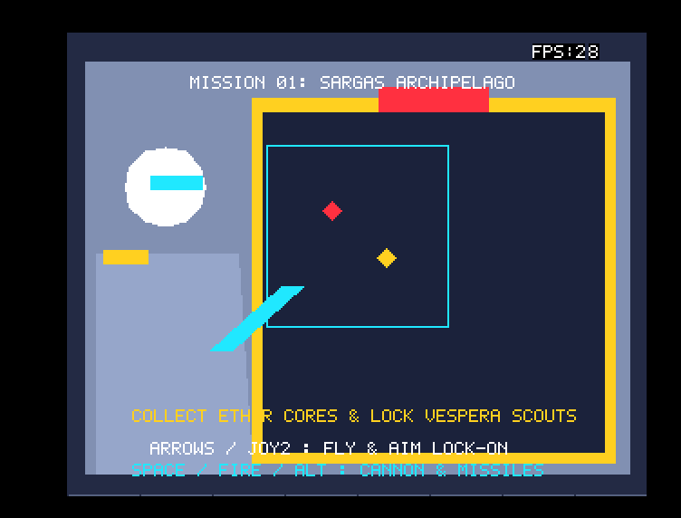 | 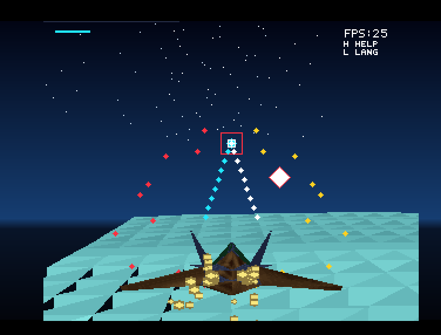 |  |
|:---:|:---:|:---:|:---:|
| **1. Intro: Motocykl & Pilot** | **2. Briefing & Klawisze** | **3. Lot 3D & Działka** | **4. Raport Końcowy (Debriefing)** |

- **Wieloaktowe Intro Top Gun (`src/af_vector_scenes.i`):** sekwencja dojazdu motocykla pod hangar Solis, podejścia pilota do kokpitu XF-14, startu z dopalaczem oraz pojawienia się logo i tytułu gry na tle lecącego w dal myśliwca.
- **Podwójne wiązki działek plazmowych (`src/af_gameplay_3d.i`, `input_ctrl.i`):** natychmiastowy ostrzał działkami pod `Spacja / Fire / Alt / Enter` + salwy rakiet Multi-Lock.
- **Klawiszologia na Briefingu i pod `H` wyłącznie w grze (`src/af_campaigns.i`, `hud_fps.i`):** czysty licznik `FPS` w Intro/Briefingu/Debriefingu oraz dedykowana tabela sterowania gry.

---

## [v0.0.4] - 2026-11-25

- **Plynna fizyka lotu i ograniczniki sterow (`src/aether_falcon.s`):** dodano progresywne tlumienie przechylow (`Roll`) oraz twarde ograniczniki pochylenia (`Pitch` `-110..+110`), eliminujace wyjscie kamery poza korytarz kanionu.
- **Dynamiczna kamera dopalacza i animacja aerodynamiczna XF-14 (`src/af_gameplay_3d.i`):** odrzut kamery przy wlaczeniu dopalacza (`cam_oz = -168`) oraz subtelne mikrokolebanie kadluba w strugach powietrza.
- **Wersja THEA1200 16:9 Widescreen (`320x256` PAL):** pelnoekranowa korekcja proporcji anamorficznych `3/4` oraz pelne 256-liniowe przycinanie terenu 3D (`#520`).

---

## [v0.0.3] - 2026-11-25

- **Obsluga dysku twardego (`src/af_disk_loader.i` - `dos.library`):** wczytywanie z katalogu `data/` parametrow kampanii (`missions.dat`), rekordu punktow (`hiscore.dat` z automatycznym zapisem przy wyjsciu), ekranu AGA (`title.chk` + `title.pal`) oraz sampla PCM dla Pauli (`intro.pcm`), automatycznie pakowanych do `.lha` i `_FSUAE.zip`.
- **Silnik scen wektorowych N-gon w stylu *Another World* (`src/af_vector_scenes.i`):** niezalezna paleta fabularna AGA i tla, szybki rasteryzer wielokatow N-gon (`16.16` fixed-point + zapisy 32-bitowe `move.l`), animowany start **XF-14 Albatros** z lotniskowca *Solis* oraz reakcyjny *Briefing* i *Debriefing*.
- **Boss Misji 03 (*Latajaca Forteca Lewiatan*) i eksplozje czasteczkowe 3D:** cytadela na koncu Misji 03 z **4 niezaleznymi reaktorami** *Multi-Lock*, rozbryzg 3D odlamkow z efektem wybuchu na kanale 3 ukladu Paula oraz pelna petla kampanii (`Misje 01 -> 02 -> 03 -> Final`).
- **Optymalizacja FPS pod bazowa Amige 1200 (`68EC020` 14 MHz):** redukcja siatki terenu z `16x13` do `12x10` z szybkim wypelnianiem 32-bitowym bez narzutu Z-buffera, selektywne czyszczenie `zbuf_3d` wylacznie pod mysliwcem XF-14 oraz pelna kalibracja celownika i HUD w trybie `320x128`.

<table><tr><td align="center">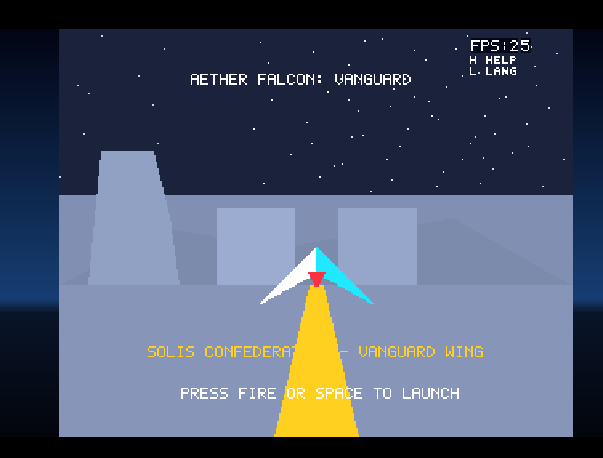 <b>Intro: Lotniskowiec Solis (v0.0.3)</b></td><td align="center"> <b>Briefing: Mapa N-gon (v0.0.3)</b></td><td align="center"> <b>Lot 3D &amp; Kanion 12x10 (v0.0.3)</b></td></tr></table>

---

## [v0.0.2] - 2026-11-25

- **Ujednolicony potok 256-kolorowy AGA (`Intro -> Briefing -> 3D Gameplay -> Debriefing`):** przeniesiono renderowanie ekranów wektorowych i odpraw misji do wspólnego bufora `chunky_buf` + C2P AGA z kontrastową paletą HUD (`$FC..$FF`).
- **Poprawka czcionki bitmapowej `5×7` i prymitywów HUD:** naprawiono 8-bajtowy krok znaków `hud_ascii_5x7` (bity `4..0`), wdrożono pełne 4-boczne ramki celownika **Lock-On** oraz wypełnione romby emblemu Konfederacji Solis.
- **Pozycja myśliwca XF-14 „Albatros” i sterowanie klawiaturą:** wyniesiono sylwetkę myśliwca wyraźnie ponad przewijany teren 3D (`Y=12`, `Z=22`), dodano pełne sterowanie lotem i celownikiem z klawiatury (`Strzałki + Spacja`) obok portu Joysticka 2 oraz flagę `-DM68060` dla profilu `060`.
- **Utwardzenie alokacji Chip/Fast RAM i wektora VBR:** przeniesiono bitplany AGA (`180 KB MEMF_CHIP`) oraz tablicę `fill_lut` (`512 KB MEMF_FAST`) do dynamicznej alokacji `Exec AllocMem`, dodano odczyt rejestru `VBR` przez `Exec Supervisor()` dla przerwania 50 Hz VBL oraz cache palety na ekranach menu.

<table><tr><td align="center">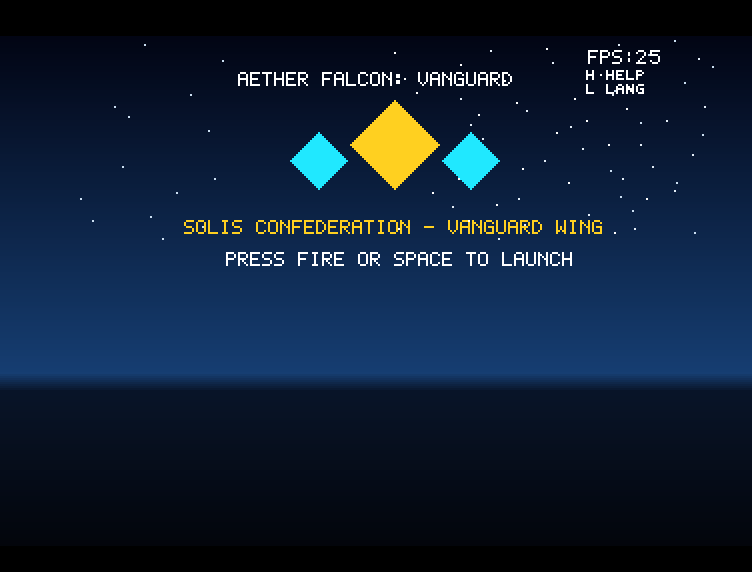 <b>Ekran Tytulowy (v0.0.2)</b></td><td align="center">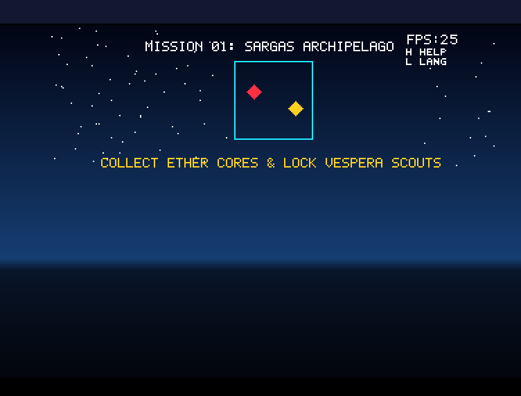 <b>Briefing (v0.0.2)</b></td><td align="center">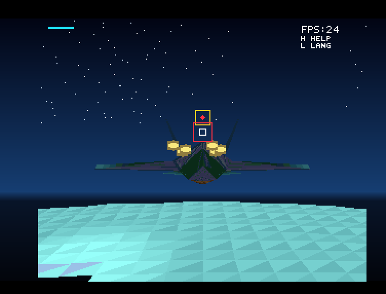 <b>Lot 3D XF-14 (v0.0.2)</b></td></tr></table>

---

## [v0.0.1] - 2026-11-25

- **Pierwsze wydanie szkieletu gry (Bare-Metal M68k):** implementacja maszyny stanów kampanii (`Intro -> Briefing -> Gameplay -> Debriefing`) oraz 3 misji (*Sargas Archipelago*, *Krell Storm Canyon*, *Leviathan Citadel*).
- **Autorski model 3D myśliwca XF-14 „Albatros”:** proceduralnie wygenerowana siatka 3D (`29` wierzchołków, `38` trójkątów wielomateriałowych z normalnymi do cieniowania Gouraud/Specular) oraz podwójna smuga spalin z dysz.
- **Mechanika rozgrywki i system Lock-On:** przelot nad terenem wysokościowym 3D, zbieranie Rdzeni Eteru, celownik 2D/3D z jednoczesnym namierzaniem do 8 celów i salwami samonaprowadzających rakiet.
- **Audio ProTracker `.MOD` + Paula SFX:** 4-kanałowy odtwarzacz muzyki połączony ze sprzętowym sterownikiem efektów dźwiękowych na kanale 3 układu Paula (`Lock-On`, salwa rakiet, zebranie Rdzenia Eteru).
- **System budowania 3 profili wydawniczych (`tools/build_game.py`):** automatyczna kompilacja paczek `.lha` (WHDLoad Slave v17 + ikonka `.info`) oraz `_FSUAE.zip` dla profili `standard` (`020`), `thea1200` (`FULL_RES`) i `060` (`MC68060`).
