## v0.2.0.4 (2026-11-27)
- Open-world terrain & seed generator (`SEED`), 8 colony bases, 8 anomaly crystals, rotating 360° radar, and topographic map (`J`).
- Bilingual HDD-loaded campaign (`PL` with Polish diacritics & `EN`), cinematic Prologue and Act III Epilogue.
- 3 distinct 3D hovercraft meshes per class (Pioneer, Guardian, Engineer), 6 AGA portraits, and 4 ProTracker `.MOD` soundtrack modules.

| 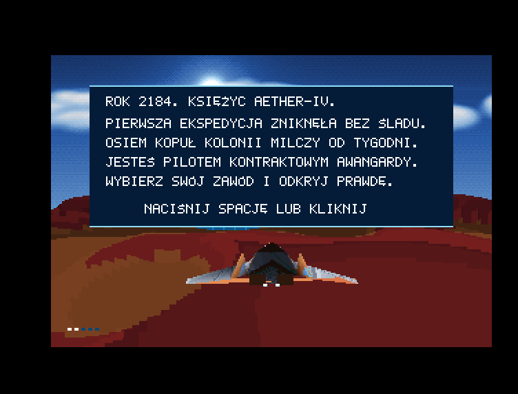 | 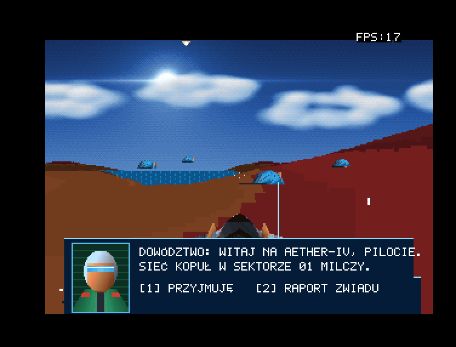 | 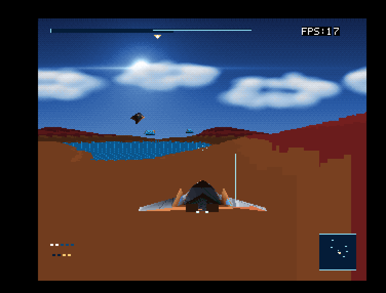 |
|:---:|:---:|:---:|
| **1. 3D Hovercraft & Colony Domes** | **2. Sector Officer Comms** | **3. Logbook & Topographic Map** |

<a href="CHANGELOG.md">Polski</a> | <strong>English</strong> | <a href="README_EN.md">README</a>

# Changelog — AETHER FALCON: VANGUARD

All notable changes to **AETHER FALCON: VANGUARD** are documented in this file.

---

## [v0.2.0.2] - 2026-11-27

| 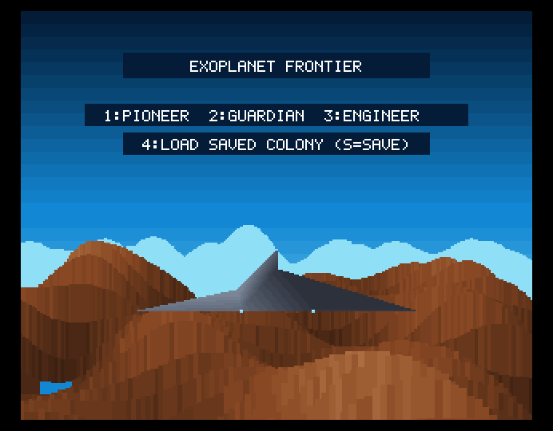 | 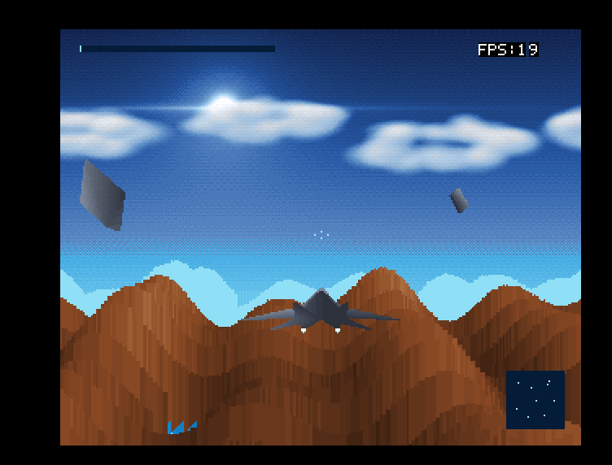 |  |
|:---:|:---:|:---:|
| **1. Start Menu with Cinema Letterbox** | **2. Dialogue Box with Animated Portrait** | **3. 360° Flight with Water Reflections & 3D Meshes** |

- **Frozen 68040 / THEA1200 Engine Layer (`0 errors, 0 warnings`):** all engine modules verified in practice and synced across `src/` and `refs/aura3d/engine/`.
- **Water Reflections, 3D Ground Shadows & Flight Controller (`terrain_3d.i`, `vec3d_engine.i`, `flight_ctrl.i`):** animated sky reflections on water surfaces, terrain-projected shadows underneath 3D meshes (`vx_ybuf`), smooth 360° yaw/bank, horizon pitch (`cam_pitch`), and terrain collision floor protection.
- **Cinematic Engine & THEA1200 Mouse Support (`cinematic_fx.i`, `thea1200_hw.i`):** smooth letterbox bar open/retract, dialogue box with animated portrait and typewriter effect, 24-bit AGA palette fader & mood tinting, and full mouse support (`$DFF00A` + LMB) across menus, dialogues, and flight.
- **32-Bit 68040 C2P (`c2p_chunky.i`):** enabled full 32-bit planar conversion pipeline for `FULL_RES` (`320×256 AGA`).

---

## [v0.2.0.1] - 2026-11-27

- **Complete 68040 / THEA1200 Engine Milestone (`0 errors, 0 warnings`):** finalized the engine layer with all modules synced across `src/` and `refs/aura3d/engine/`.
- **Voxel Space 3D Terrain Engine (`terrain_3d.i`):** incremental 68040 raymarching (zero `muls.w` inside the inner ray loop), `vx_row_lut` row address LUT, dynamic horizon pitch (`cam_pitch`), 320-column depth buffer (`vx_ybuf`), and biosphere color shift.
- **3D Mesh & Particle Engine (`vec3d_engine.i`, `aura3d_v2.i`):** Gouraud-shaded 3D polygon rendering with `movem.l` Z-buffer clear (32B/cycle), 360° sun with atmospheric corona, 360° clouds, 32-slot 3D particle system, and Bresenham 2D line rasterizer.
- **Cinematic, Narrative & THEA1200 Hardware Engine (`cinematic_fx.i`, `thea1200_hw.i`):** cinema letterbox bars, 2D polygon rasterizer for portraits/cutscenes, portrait dialogue box, smooth camera choreographer, 24-bit AGA 8-bank palette fader, and simultaneous keyboard, Amiga mouse (`$DFF00A`), and multi-button gamepad (`$DFF016`) support.

---

## [v0.2.0.0] - 2026-11-26

|  | 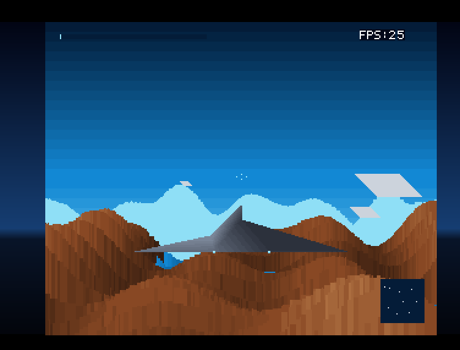 |
|:---:|:---:|
| **1. Title Menu: Role & Save Selection** | **2. 360° Voxel Space 3D Flight & Radar** |

- **Dedicated 68040 Engine for THEA1200 (`src/aether_falcon.s`, `tools/build_game.py`):** switched target build to `-m68040` in full `320×256 AGA` (256 colors) and synced all new engine modules into `refs/aura3d/engine/`.
- **360° Voxel Space 3D Terrain with Depth Buffer (`vx_ybuf`) & Distance Fog (`Z-Fog`):** full 360° flight over exoplanet mountain ranges and lakes (`data/exo_voxel.bin`, `data/exo_pal256.bin`).
- **Gameplay Skeleton, Role Menu & Disk Save (`exo_menu.i`, `exo_world_objs.i`, `exo_save_load.i`, `exo_victory.i`):** New Campaign selection (`1: PIONEER`, `2: GUARDIAN`, `3: ENGINEER`), Load Saved Colony (`4: LOAD SAVED COLONY`), auto-save & manual save (`S`) to `data/colony.sav`, `256×256` radar, live `FPS` counter, clean `.MOD` soundtrack (`data/exo_theme.mod`), and Paula DMA SFX (`exo_sound.i`).

---

## [v0.1.3] - 2026-11-25

| 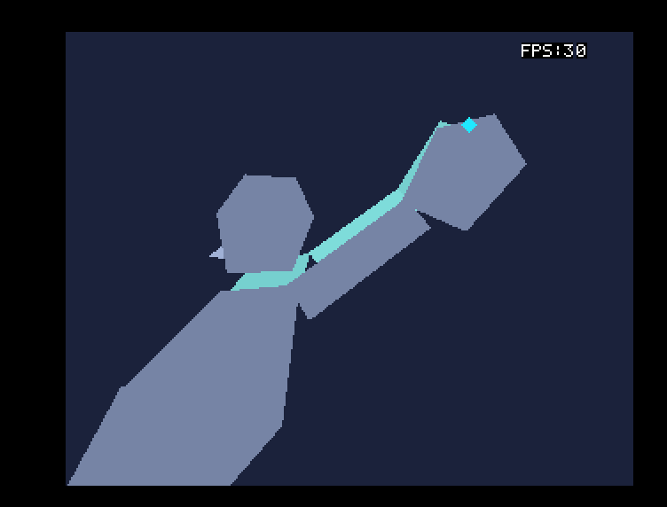 | 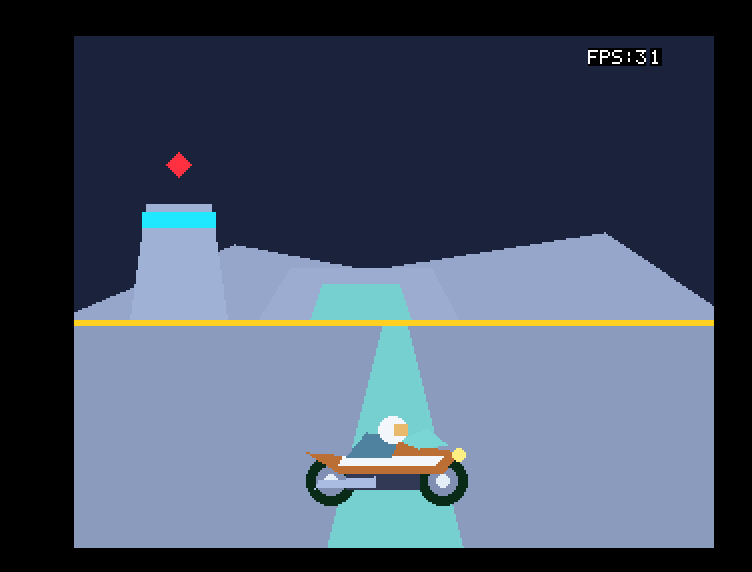 | 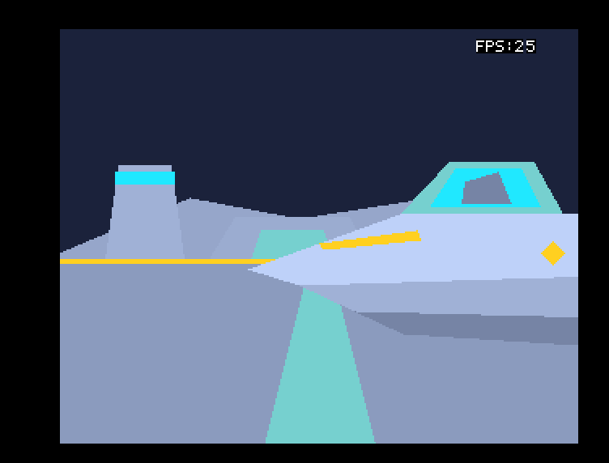 |
|:---:|:---:|:---:|
| **1. Act I: Salute to the Sky** | **2. Act II: Solis Airbase** | **3. Act III: XF-14 Cockpit** |
| 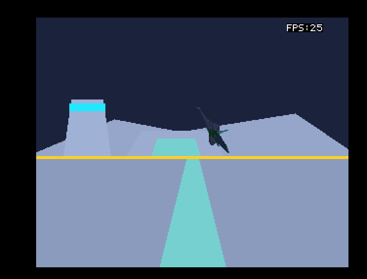 | 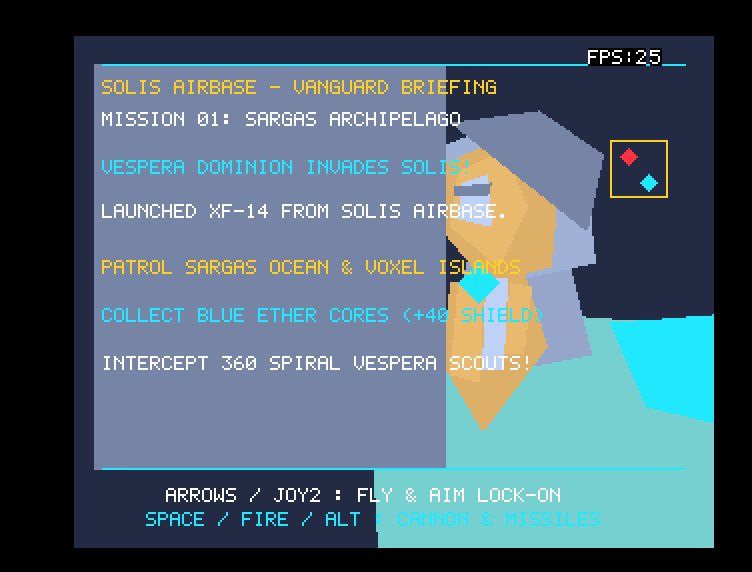 | 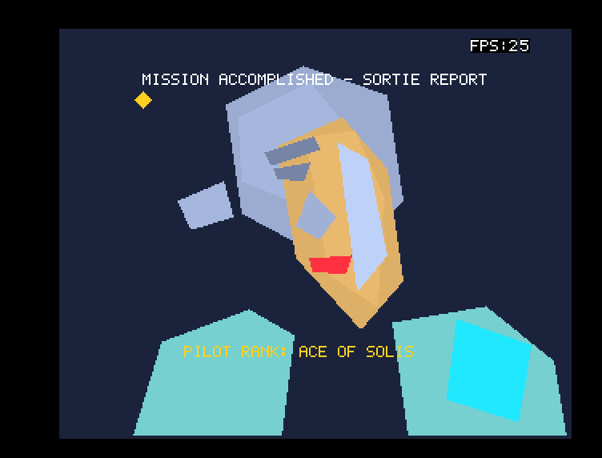 |
|:---:|:---:|:---:|
| **4. Act IV: 3D XF-14 Launch** | **5. Briefing: Commander** | **6. Debriefing: Pilot Portrait** |

- **Mission 03 Boss Leviathan & 4 Orbiting Reactors (`src/af_gameplay_3d.i`):** automatically spawns the 3D Leviathan Flying Fortress and its 4 orbiting reactor cores with target brackets upon entering Mission 03 (*Leviathan Citadel*).
- **Unified *Eon* (TBL) Visual Style Across All 5 Intro Acts (`src/af_vector_scenes.i`):** replaced the legacy bitmap airbase backdrop in Acts 2–4 with a cohesive borderless multi-tone vector scene matching the *Eon* palette (`#16`, `#22..#24`, `#215`, `#253`, `#254`).

---

## [v0.1.2] - 2026-11-25

- **Full 5-Act Rotoscoped *Eon* (TBL) Style Cinematics (`src/af_vector_scenes.i`):** expanded multi-scene animated movies for the game opening (**Intro** — 5 acts: *Salute to the Sky*, Solis airbase alert, XF-14 cockpit afterburner ignition, 3D launch into space, and title), mission start (**Briefing** with animated Commander portrait & hologram), and mission end (**Debriefing / Game Over** with animated 3/4 Pilot portrait).

---

## [v0.1.1] - 2026-11-25

- **Multi-Tone Rotoscoped *Eon* (The Black Lotus) Style Story Scenes (`src/af_vector_scenes.i`, `src/af_campaigns.i`):** borderless multi-faceted polygon scene player `af_play_eon_scene` across all 3 narrative screens:
  - **Intro (Act I — "Salute to the Sky"):** silhouette of the Vanguard pilot raising a fist against a silver sky (`#30`) with cool steel-cyan rim lighting (`#215`/`#217`).
  - **Briefing ("Commander’s Vigil"):** multi-tone portrait of the Vanguard Squadron Commander resting his chin on his hand alongside the tactical briefing panel.
  - **Debriefing / Game Over ("Pilot’s Resolve"):** dramatic 3/4 side-lit pilot portrait against deep black (`#16`).

---

## [v0.1.0] - 2026-11-25

| 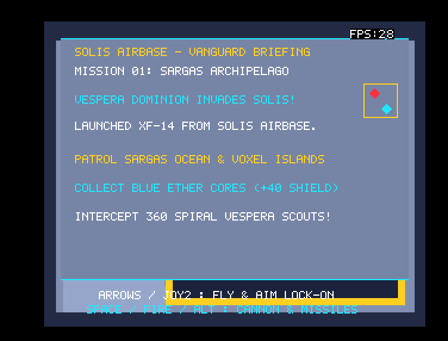 | 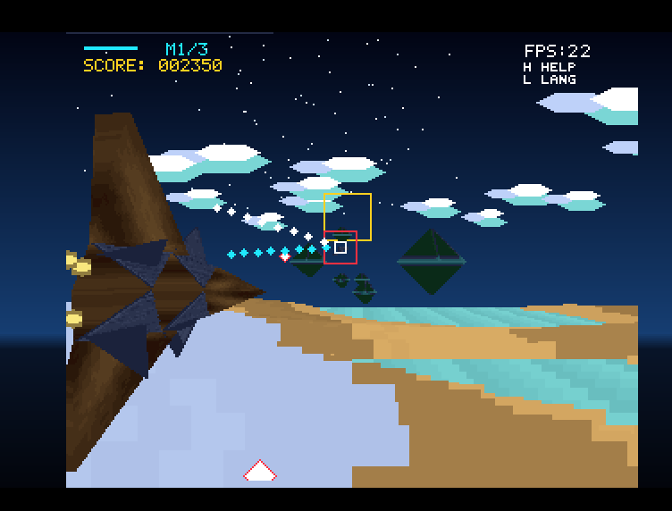 |
|:---:|:---:|
| **1. Tactical Mission Briefing Board** | **2. Volumetric 3D Clouds, Voxels & Live SCORE** |

- **Volumetric 3D Sky Clouds (`af_draw_3d_clouds` in `src/af_voxel_world.i`):** 16 layered 3D cloud formations with perspective scrolling, flight parallax, and mission-adaptive atmosphere (sunlit cumulus in Mission 01, storm clouds in Mission 02, volcanic ash clouds in Mission 03).
- **Activated `AURA-3D` Shader & Shadow Effects:** enabled `zfog_enabled` depth fog, `phong_enabled` + Fresnel rim lighting, and real-time ground shadow beneath the XF-14 Albatros fighter.

---

## [v0.0.9] - 2026-11-25

| 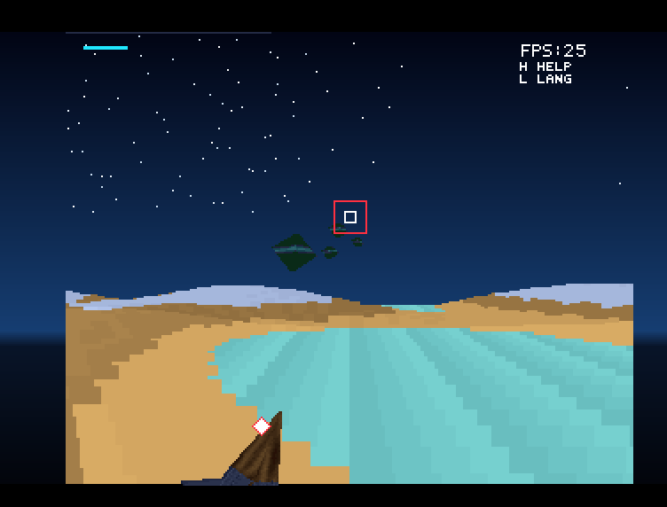 | 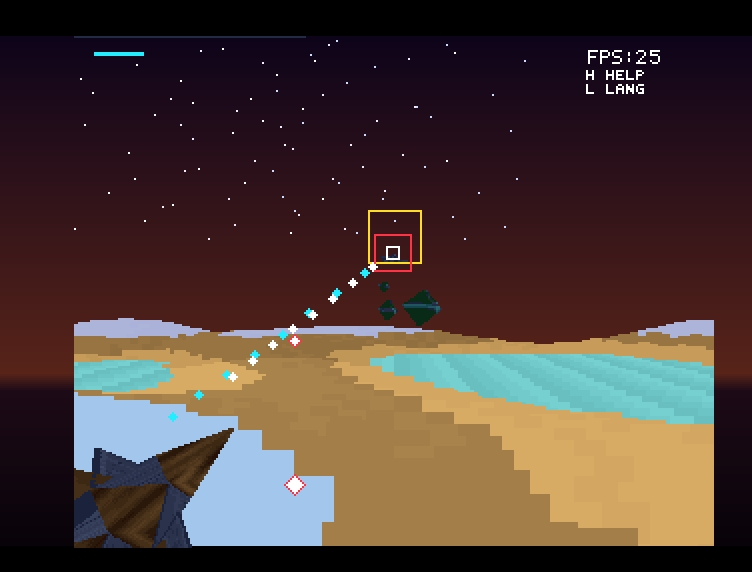 | 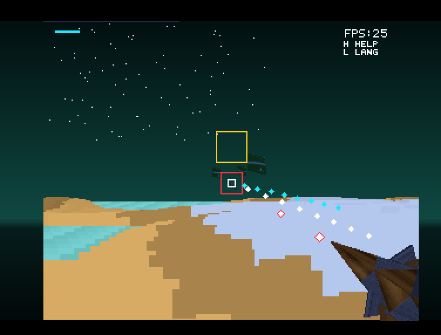 |
|:---:|:---:|:---:|
| **1. Voxel Ocean & Islands** | **2. 360° Flight & 3D Lock-On** | **3. Voxel Mountains, Land & 3D Meshes** |

- **3D Voxel Space Terrain Engine (`src/af_voxel_world.i`):** column-based Voxel Space raycaster (160 double columns = 320 px AGA with horizon Y-buffer) rendering animated ocean waves, sandy islands, and mountains in Mission 01, deep canyon cliffs & storm river in Mission 02, and volcanic terrain with citadel towers in Mission 03.
- **3D Lock-On Reticle & Near-Plane Guard (`src/af_gameplay_3d.i`):** snapped Lock-On reticle to projected 3D enemy nose coordinates and added near-plane mesh clipping (`Z >= 180`).

---

## [v0.0.8] - 2026-11-25

- **True 3D Gouraud / EnvMap Meshes for Enemies, Ether Cores & Leviathan Boss (`src/af_enemy_meshes.i`, `src/af_gameplay_3d.i`):** generated via `refs/aura3d/tools/mesh_conv.py` multi-polygon 3D meshes for *Vespera Interceptors* (14 verts, 24 tris), rotating crystal *Ether Cores* (6 verts, 8 tris), and the Mission 03 *Leviathan Citadel* (16 verts, 28 tris + 4 orbiting 3D core reactors) rendered with full-screen Z-buffering (`320x256` / `320x128`).
- **Story Overview & 3D Object Guide in Documentation (`README.md`, `README_EN.md`):** added the 3-mission campaign briefing and pilot reference table (enemy fighters, Ether Cores, bolts, and Leviathan Boss).

---

## [v0.0.7] - 2026-11-25

| 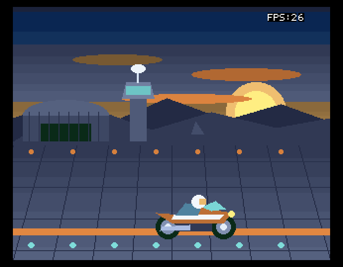 |  | 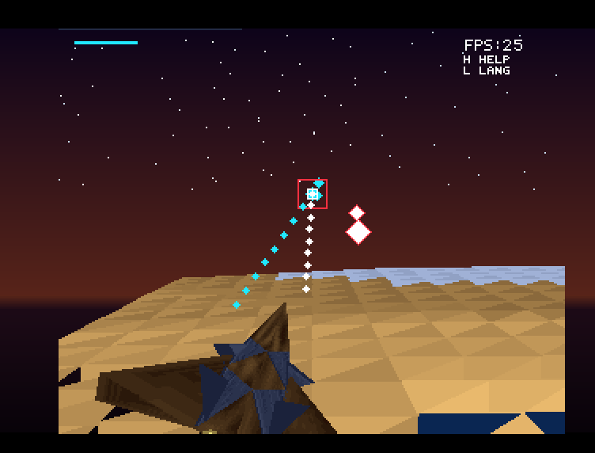 | 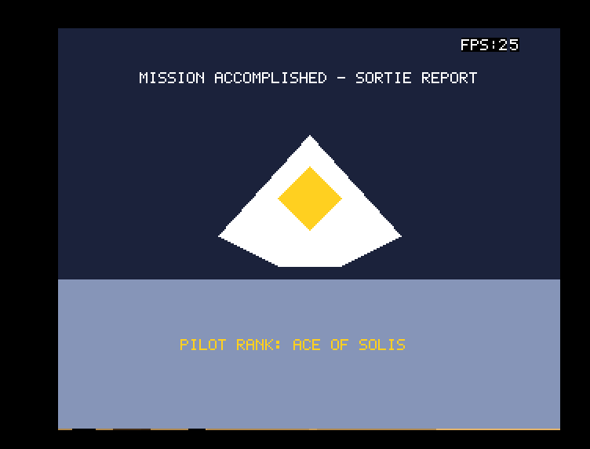 |
|:---:|:---:|:---:|:---:|
| **1. 360° Rigid XF-14 Flight** | **2. 360° Enemy Formations** | **3. 360° Leviathan Boss** | **4. Game Over / Debriefing** |

- **Rigid 360-Degree Cylindrical Orientation for XF-14 Albatros (`src/af_gameplay_3d.i`, `src/aether_falcon.s`):** orthonormal *Gyruss / Tempest*-style rotation matrix keeping the nose aimed toward screen center, belly outward toward screen perimeter, and wings tangent along the circle; Up/Down controls adjust orbit radius without pitching the hull.
- **Shield Damage System & Game Over / Debriefing Screen (`src/af_gameplay_3d.i`, `src/af_campaigns.i`):** full 2D 360-degree hit detection, state-colored shield bar (cyan/gold/red), red alert flash with `SHIELD HIT!` / `CRITICAL SHIELD!` HUD warnings, and dedicated `GAME OVER - XF-14 DESTROYED` debriefing screen with instant campaign restart on shield depletion.
- **New 360-Degree Enemy Formations & Mission 03 Leviathan Boss Fight (`src/af_gameplay_3d.i`):** spiral and double-helix 360-degree enemy waves plus a centered Leviathan citadel featuring 4 orbiting 360-degree reactors and radial plasma barrages.

---

## [v0.0.5] - 2026-11-25

| 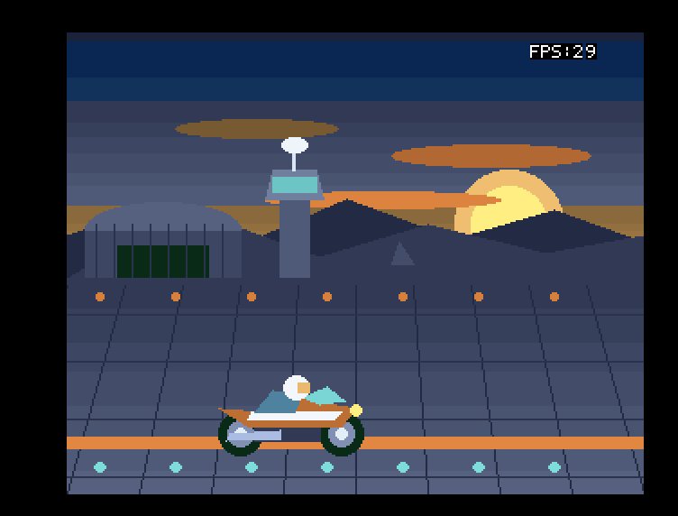 | 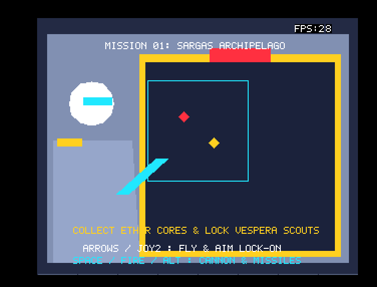 | 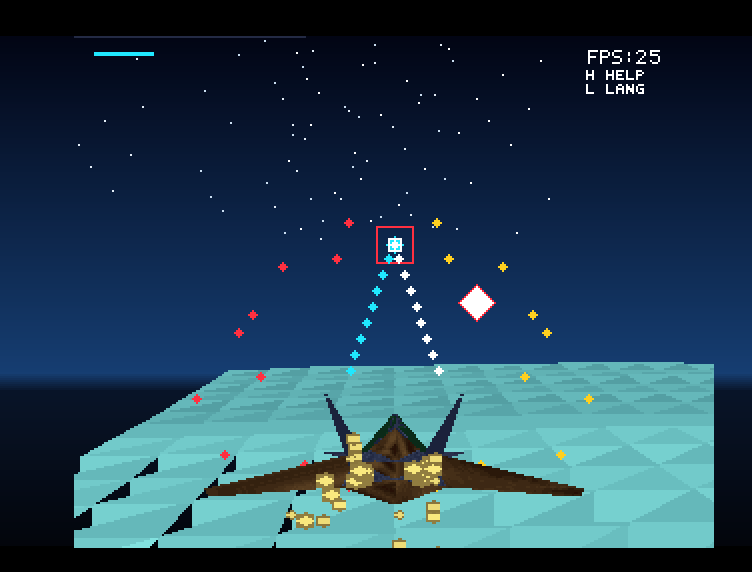 | 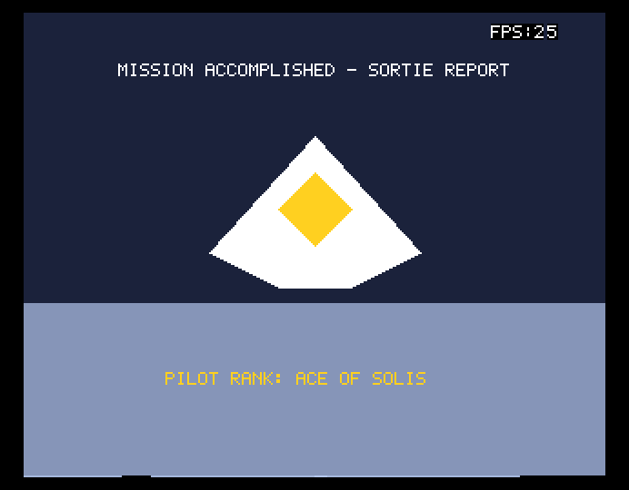 |
|:---:|:---:|:---:|:---:|
| **1. Intro: Bike & Pilot** | **2. Briefing & Controls** | **3. 3D Flight & Cannons** | **4. Sortie Report (Debriefing)** |

- **Multi-Act Top Gun Intro (`src/af_vector_scenes.i`):** motorcycle arrival at Solis carrier deck, pilot boarding XF-14 cockpit, afterburner takeoff, and title/emblem reveal as the jet flies into the distance.
- **Twin Plasma Cannon Beams (`src/af_gameplay_3d.i`, `input_ctrl.i`):** instant twin wingtip plasma beams on `Space / Fire / Alt / Enter` plus Multi-Lock missile salvos.
- **Briefing Controls & Gameplay-Only `H` Help (`src/af_campaigns.i`, `hud_fps.i`):** clean `FPS`-only overlay on vector screens and dedicated game control map during 3D missions.

---

## [v0.0.4] - 2026-11-25

- **Smooth Flight Physics & Control Clamps (`src/aether_falcon.s`):** added progressive roll damping and strict pitch clamps (`-110..+110`) to keep camera altitude locked inside the canyon corridor.
- **Dynamic Afterburner Camera & XF-14 Aerodynamic Bobbing (`src/af_gameplay_3d.i`):** camera pullback during afterburner boost (`cam_oz = -168`) plus subtle airstream hover oscillation.
- **THEA1200 16:9 Widescreen Polish (`320x256` PAL):** full-screen `3/4` anamorphic aspect correction and seamless 256-line 3D terrain edge culling (`#520`).

---

## [v0.0.3] - 2026-11-25

- **Hard Drive Support (`src/af_disk_loader.i` - `dos.library`):** loads campaign parameters (`missions.dat`), persistent high score (`hiscore.dat` saved automatically on exit), optional AGA title screen (`title.chk` + `title.pal`), and Paula PCM audio (`intro.pcm`) from `data/`, automatically bundled into `.lha` and `_FSUAE.zip` packages.
- ***Another World*-Style N-gon Vector Scene Engine (`src/af_vector_scenes.i`):** independent story AGA palette and backgrounds, fast `16.16` fixed-point N-gon polygon rasterizer with 32-bit `move.l` spans, animated **XF-14 Albatros** carrier launch *Intro*, and reactive *Briefing* / *Debriefing* screens.
- **Mission 03 Boss (*Leviathan Flying Fortress*) & 3D Particle Explosions:** multi-part citadel at the end of Mission 03 featuring **4 independent reactors** targeted via *Multi-Lock*, 3D debris bursts with Paula channel 3 explosion SFX, and full campaign progression (`Missions 01 -> 02 -> 03 -> Finale`).
- **FPS Optimization for Stock Amiga 1200 (`68EC020` 14 MHz):** reduced terrain mesh density from `16x13` to `12x10` with fast 32-bit painter spans bypassing Z-buffer overhead, selective `zbuf_3d` clearing strictly beneath the XF-14 fighter, and full `320x128` HUD/reticle coordinate alignment.

<table><tr><td align="center">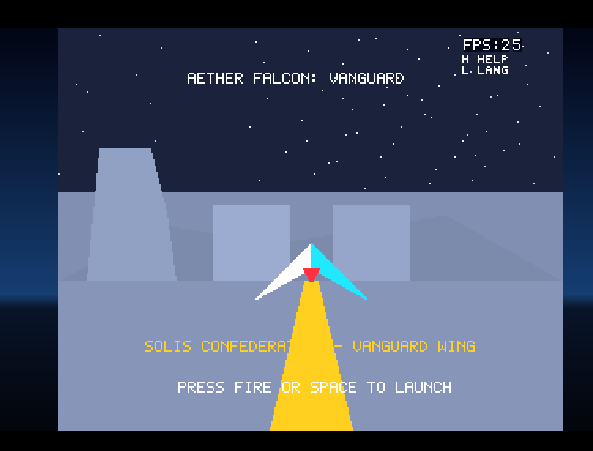 <b>Intro: Solis Carrier (v0.0.3)</b></td><td align="center">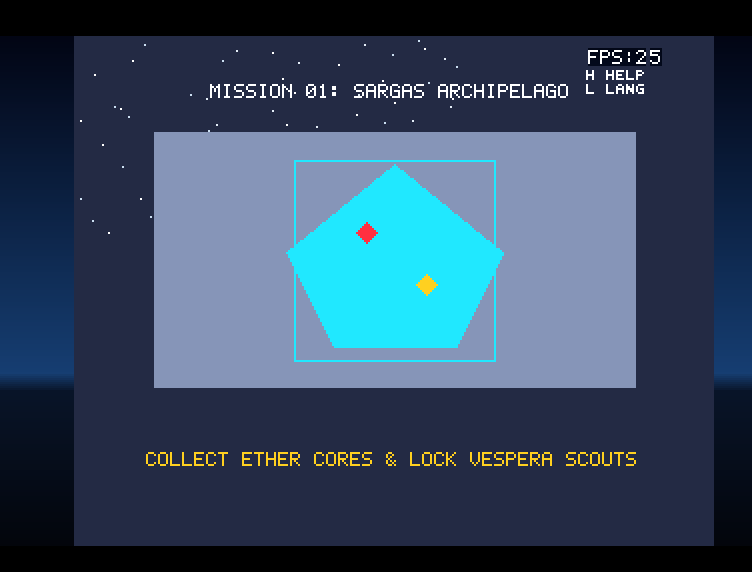 <b>Briefing: N-gon Map (v0.0.3)</b></td><td align="center">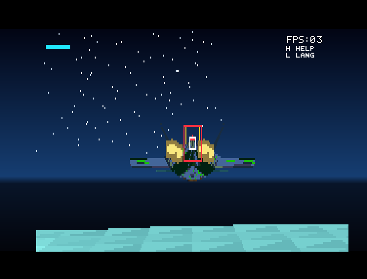 <b>3D Flight &amp; 12x10 Canyon (v0.0.3)</b></td></tr></table>

---

## [v0.0.2] - 2026-11-25

- **Unified 256-Color AGA Pipeline (`Intro -> Briefing -> 3D Gameplay -> Debriefing`):** unified vector and mission briefing screens into the shared `chunky_buf` + AGA C2P pipeline with high-contrast HUD palette indices (`$FC..$FF`).
- **Fixed `5×7` Bitmap Font & HUD Primitives:** corrected 8-byte stride decoding in `hud_ascii_5x7` (bits `4..0`), implemented full 4-sided **Lock-On** reticle frames, and added filled Solis Confederation emblem diamonds.
- **XF-14 "Albatros" Elevation & Keyboard Controls:** raised the interceptor mesh cleanly above the scrolling 3D heightmap terrain (`Y=12`, `Z=22`), added full keyboard flight and reticle controls (`Arrows + Space`) alongside Joystick Port 2, and enabled `-DM68060` for the `060` profile.
- **Chip/Fast RAM & VBR Hardening:** allocated AGA bitplanes (`180 KB MEMF_CHIP`) and `fill_lut` (`512 KB MEMF_FAST`) via `Exec AllocMem`, installed the 50 Hz VBL interrupt using `VBR` read via `Exec Supervisor()`, and cached palette uploads on menu screens.

<table><tr><td align="center">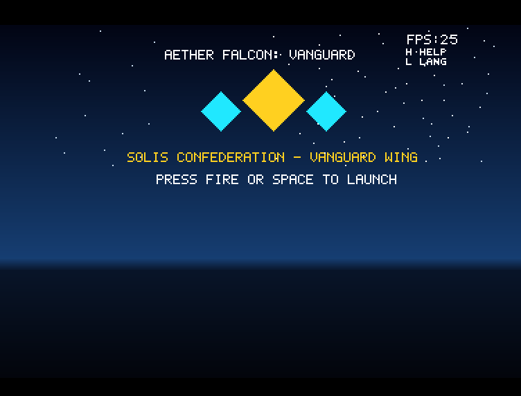 <b>Title Screen (v0.0.2)</b></td><td align="center">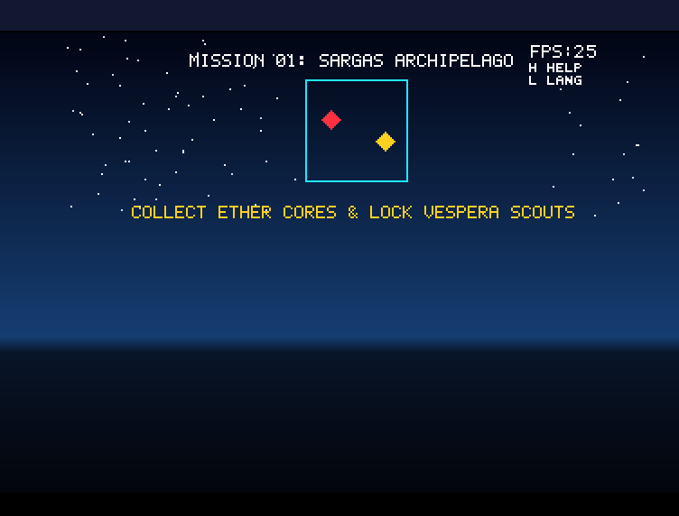 <b>Briefing (v0.0.2)</b></td><td align="center">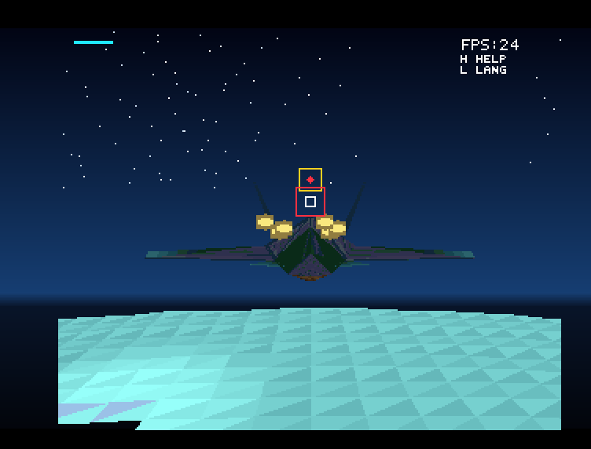 <b>3D Flight XF-14 (v0.0.2)</b></td></tr></table>

---

## [v0.0.1] - 2026-11-25

- **Initial Bare-Metal M68k Skeleton:** implemented the campaign state machine (`Intro -> Briefing -> Gameplay -> Debriefing`) and 3 sorties (*Sargas Archipelago*, *Krell Storm Canyon*, *Leviathan Citadel*).
- **Original XF-14 "Albatros" 3D Fighter Mesh:** procedurally generated multi-material 3D mesh (`29` vertices, `38` triangles with vertex normals for Gouraud/Specular shading) and twin-nozzle particle trails.
- **Gameplay Loop & Multi-Lock System:** low-altitude 3D heightmap flyover, Ether Core energy harvesting, 2D/3D Lock-On reticle supporting up to 8 simultaneous target locks, and homing missile barrages.
- **ProTracker `.MOD` + Paula SFX Audio:** 4-channel `.MOD` soundtrack paired with a bare-metal Paula channel 3 sound effects driver (`Lock-On` ping, missile launch, Ether Core pickup).
- **3-Profile Release Build System (`tools/build_game.py`):** automated generation of `.lha` (WHDLoad Slave v17 + `.info` icon) and `_FSUAE.zip` archives for `standard` (`020`), `thea1200` (`FULL_RES`), and `060` (`MC68060`).
