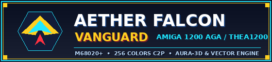
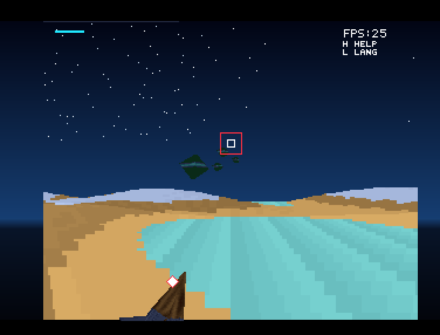
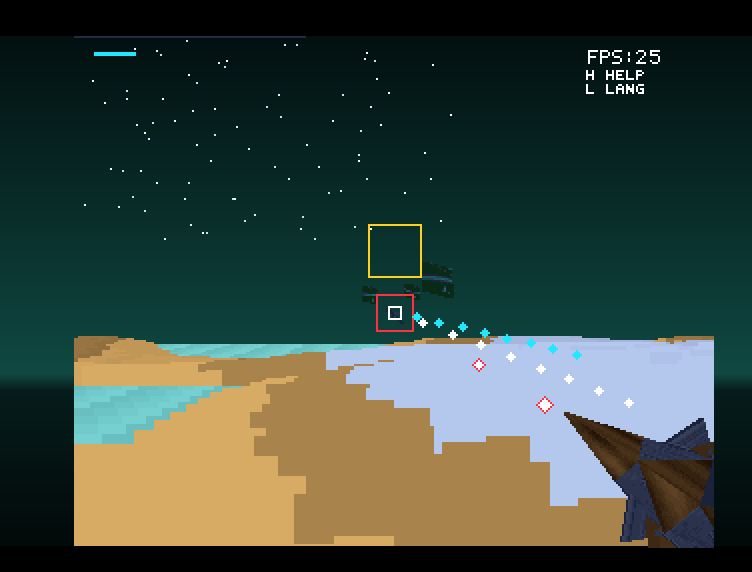
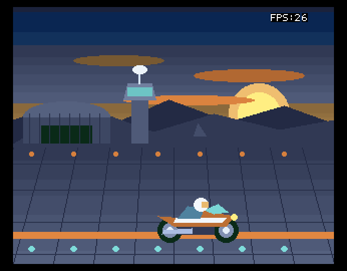
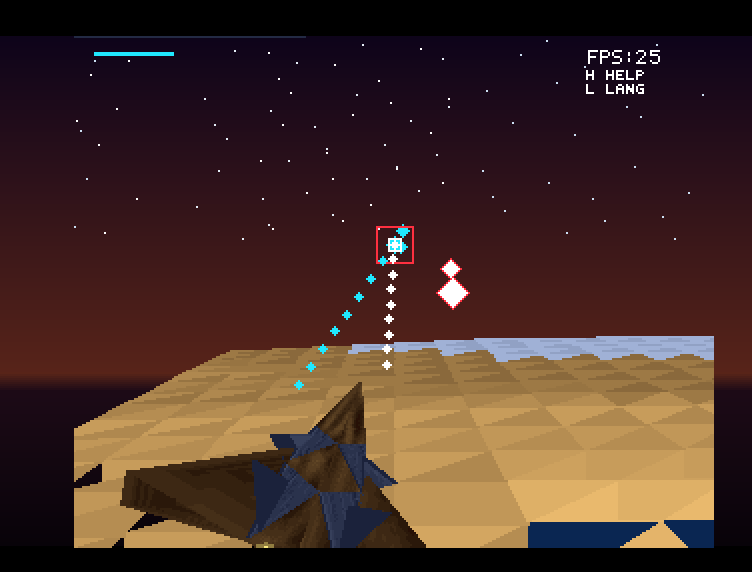
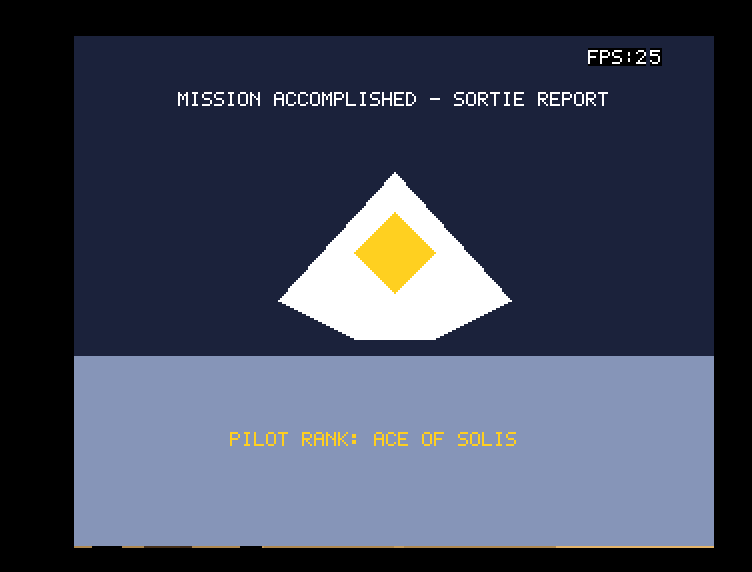

<p align="center"></p>

<p align="right"><strong>Polski</strong> | <a href="README_EN.md">English</a> | <a href="CHANGELOG.md">Changelog</a></p>

<div align="center">
  <h1>AETHER FALCON: VANGUARD v0.0.9</h1>
  <p><strong>Bare-metalowy symulator walki powietrznej 3D dla Commodore Amiga 1200 (M68020+ / AGA / 256 Colors) &amp; THEA1200</strong></p>
  <p>
    <a href="docs/">Pobierz .LHA</a> &bull;
    <a href="docs/">Pobierz FS-UAE .ZIP</a> &bull;
    <a href="CHANGELOG.md">Changelog</a>
  </p>
</div>

---

## Pobieranie (v0.0.9 — 2 Profile Sprzętowe)

| Obóz / Profil (`--profile`) | Platforma docelowa | Paczki do pobrania |
| :--- | :--- | :--- |
| **1. Standard `020` (`--profile standard`)** | Bazowa **Amiga 1200 (`68EC020`)** + Fast RAM — tryb **`320×128`** | [.LHA](docs/) · [.ZIP (FS-UAE/WinUAE)](docs/) |
| **2. THEA1200 (`--profile thea1200`)** | Konsola **THEA1200**, **Amiberry (PC)**, **FS-UAE** — pełny PAL **`320×256`** **16:9 Widescreen** (`-DFULL_RES -DWIDESCREEN_16_9`) | [.LHA](docs/) · [.ZIP (FS-UAE/WinUAE)](docs/) |

---

## Galeria Terenu Wokselowego 3D (v0.0.9 — Amiga 1200 AGA / THEA1200)

|  |  |  |
|:---:|:---:|:---:|
| **1. Wokselowy Ocean i Wyspy** | **2. Przelot 360° i Celownik 3D** | **3. Góry, Ląd i Modele 3D** |

## Galeria (v0.0.7 — Mechanika 360° & Game Over)

|  |  |  |  |
|:---:|:---:|:---:|:---:|
| **1. Orientacja 3D 360° XF-14** | **2. Formacje Wrogów 360°** | **3. Boss Lewiatan 360° (Misja 03)** | **4. Game Over / Debriefing** |

## Wykorzystane Silniki i Powiązane Repozytoria

| Logo | Silnik i Repozytorium | Rola w projekcie |
| :---: | :--- | :--- |
| <a href="docs//malek69//aura3d-aga-engine"></a> | **[AURA-3D AGA Engine](docs//malek69//aura3d-aga-engine)** | Główny potok 3D (`STATE_GAMEPLAY`), teren wysokościowy (`terrain_3d.i`), myśliwiec **XF-14 Albatros** (`aura3d_v2.i`), C2P 256 kolorów (`c2p_chunky.i`), niebo Coppera (`copper_sky.i`), smugi (`particle_trail.i`), flary (`lens_flare.i`), sterowanie (`input_ctrl.i`), czcionka 5x7 (`hud_fps.i`) oraz audio `.MOD` (`pt_player.i`). |
| <a href="docs//malek69//amiga1200-vector-engine"></a> | **[Amiga 1200 Vector Engine](docs//malek69//amiga1200-vector-engine)** | Architektura ekranów taktyczno-wektorowych (**Intro**, **Briefing** z mapą sektora i **Debriefing** z oceną pilota w `src/af_campaigns.i`), zintegrowana ze wspólnym buforem 256 kolorów AGA. |
---

## Fabuła i Kampania (3 Misje)

Jako pilot elitarnej eskadry **Vanguard** startujesz myśliwcem przechwytującym **XF-14 Albatros** z pokładu bazy lotniczej (lotniska) **Solis**, aby powstrzymać inwazję **Dominium Vespera** na Konfederację Solis:

1. **Misja 01 — Sargas Archipelago:** Lot patrolowy nad archipelagiem, zbieranie rozproszonych **Rdzeni Eteru** i przechwytywanie eskadr zwiadowczych Vespera lecących w formacji spiralnej 360°.
2. **Misja 02 — Krell Storm Canyon:** Szybki przelot przez burzowy kanion Krell, gdzie przeciwnicy atakują w podwójnej helisie 360° i wymagają salw rakiet *Multi-Lock*.
3. **Misja 03 — Leviathan Citadel:** Ostateczny szturm na flagową **Latającą Fortecę Lewiatan** 3D unoszącą się w centrum tunelu, zasilaną przez **4 wirujące reaktory**.

---

## Obiekty w Przestrzeni 3D — Do Czego Strzelać, a Co Zbierać?

| Obiekt 3D | Wygląd i zachowanie | Zadanie pilota |
| :--- | :--- | :--- |
| **Myśliwce Vespera (*Vespera Interceptors*)** | Ciemne myśliwce 3D lecące dziobem w Twoją stronę; celownik automatycznie nakłada na nie ramkę **Lock-On**. | **Zestrzeliwać** — działkami plazmowymi ze skrzydeł i rakietami samonaprowadzającymi (*Multi-Lock*). |
| **Rdzenie Eteru (*Ether Cores*)** | Wirujące, błękitno-turkusowe kryształy 3D (oktaedry) unoszące się w tunelu. | **Nie strzelać — zbierać!** Przelot blisko kryształu regeneruje **+40 energii tarczy** i dodaje **+250 pkt**. |
| **Ogniste pociski wroga** | Czerwono-białe kule energii lecące z głębi tunelu przez Twoją pozycję aż za krawędź ekranu. | **Unikać** na okręgu 360° — każde trafienie zabiera **25 pkt tarczy** (`SHIELD HIT!`). |
| **Boss Lewiatan i 4 Reaktory (Misja 03)** | Wielobryłowa forteca 3D w centrum tunelu otoczona **4 wirującymi kryształami reaktorów**, strzelająca promieniowo. | **Namierzać i niszczyć 4 reaktory** (każdy wymaga 2 trafień), aby odnieść zwycięstwo w kampanii. |

---

## Sterowanie (Lot po Okręgu 360°)

- **Strzałki Lewo / Prawo** lub **Joystick Port 2:** lot po pełnym okręgu **360°** (dziób myśliwca zawsze w środek ekranu, brzuch na zewnątrz, skrzydła stycznie wzdłuż okręgu)
- **Strzałki Góra / Dół** lub **Joystick Port 2:** przybliżenie do środka tunelu (Góra) lub oddalenie ku krawędzi ekranu (Dół) bez pochylania kadłuba
- **Spacja / Enter / Fire / RMB:** start misji, ogień z podwójnych działek plazmowych, salwa rakiet **Multi-Lock** oraz dopalacz (*Afterburner*)
- **H / L:** panel pomocy (`HELP`) w locie oraz przełącznik języka HUD (`PL` / `EN`)
- **ESC / LMB:** zapis rekordu (`hiscore.dat`) i wyjście do AmigaOS / WHDLoad

---

## Kompilacja ze Źródeł

```bash
python3 tools/build_game.py --profile all
```

Szczegółowy rejestr zmian znajduje się w pliku [CHANGELOG.md](CHANGELOG.md).

## Narzędzia Budowania i Generatory Zasobów (`tools/`)

| Skrypt | Rola w projekcie |
|:---|:---|
| `tools/build_game.py` | Główny skrypt kompilacji (`vasmm68k_mot`) i pakowania archiwów `.LHA` oraz paczek FS-UAE/WinUAE `.ZIP` dla profili `standard` i `thea1200`. |
| `tools/gen_aga_airbase_scenes.py` | Generator pełnoekranowych teł bazy lotniczej 256 kolorów AGA (`data/bg_airbase.bin`, `320×256`) oraz spriteów (`data/spr_moto.bin`) kwantyzowanych do palety `pal256.bin`. |
| `tools/gen_vanguard_mod.py` | Generator autorskiej 4-kanałowej ścieżki dźwiękowej ProTracker `.MOD` (`data/vanguard_anthem.mod`) wolnej od praw autorskich. |

---

## Możliwości Silnika Graficznego (AURA-3D AGA + Vector Engine)

- **Rasteryzacja 3D w czasie rzeczywistym (M68020+):** cieniowanie **Gouraud** oraz **Environment Mapping** z 16-bitowym **Z-Bufferem**, obsługą tekstur i automatycznym przycinaniem brył.
- **Natywny tryb 256 kolorów AGA & C2P:** konwersja *Chunky-to-Planar* (`320×128` dla bazowej Amigi 1200 oraz pełny PAL `320×256` **16:9 Widescreen** dla THEA1200/FS-UAE) z dynamicznym gradientem nieba **Copper**.
- **Teren 3D i efekty cząsteczkowe:** generowany proceduralnie korytarz kanionu 3D, podwójne smugi silników, flary soczewkowe (*Lens Flare*), płaskie cienie (*Planar Shadows*) oraz wielopunktowe eksplozje 3D.
- **Hybrydowy potok wektorowo-poligonowy:** szybki rasteryzer wielokątów N-gon (`16.16` fixed-point) dla ekranów fabularnych (**Intro**, **Briefing**, **Debriefing / Game Over**) współdzielący bufor 256 kolorów AGA oraz 4-kanałowe audio **Paula** (`.MOD` + efekty `SFX`).
- **Strumieniowe wczytywanie i zapis danych z dysku (`dos.library` / `src/af_disk_loader.i`):** dynamiczne ładowanie zasobów z katalogu `data/` (`missions.dat`, tła 256-kolorowe `bg_airbase.bin`, `title.chk`/`title.pal`, sprite’y `spr_moto.bin`, moduł muzyczny `vanguard_anthem.mod`, sample `intro.pcm`) bezpośrednio do Fast/Chip RAM przed przejęciem sprzętu AGA, oraz trwały zapis rekordu punktowego (`data/hiscore.dat`) po zakończeniu gry.

## Konwersja Modeli 3D z Plików Wavefront `.OBJ`

Silnik zawiera gotowe konwertery pozwalające zaimportować dowolny model 3D `.OBJ` z internetu do kodu asemblera M68k:

```bash
python3 tools/mesh_conv.py --obj assets_raw/vespera_interceptor.obj --out src/custom_mesh.i --prefix custom --radius 42 --tex 0
```

## Pełna Lista Narzędzi w Katalogu `tools/`

Skrypt obejmuje kompleksowy zestaw narzędzi w katalogu `tools/` (m.in. `mesh_conv.py`, `obj2amiga.py`, `build_game.py`, `png_to_aga.py` oraz generatorów tekstur, scen i audio `.MOD`), które służą do konwersji modeli 3D, generowania zasobów graficznych AGA oraz budowania paczek `LHA` i FS-UAE.
