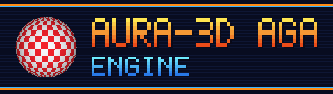

<p align="right"><strong>Polski</strong> | <a href="README_EN.md">English</a> | <a href="CHANGELOG.md">Changelog</a></p>

<div align="center">
  <h1>AETHER FALCON: VANGUARD v0.0.2</h1>
  <p><strong>Bare-metalowy symulator walki powietrznej 3D dla Commodore Amiga 1200 (M68020+ / AGA / 256 Colors) &amp; THEA1200</strong></p>
  <p>
    <a href="https://github.com">Pobierz .LHA</a> &bull;
    <a href="https://github.com">Pobierz FS-UAE .ZIP</a> &bull;
    <a href="CHANGELOG.md">Changelog</a>
  </p>
</div>

---

## Pobieranie (v0.0.2 — 3 Obozy Wydawnicze)

| Obóz / Profil (`--profile`) | Platforma docelowa | Paczki do pobrania |
| :--- | :--- | :--- |
| **1. Standard `020` (`--profile standard`)** | Bazowa **Amiga 1200 (`68EC020`)** + Fast RAM — tryb **`320×128`** | [.LHA](https://github.com) · [.ZIP (FS-UAE/WinUAE)](https://github.com) |
| **2. THEA1200 (`--profile thea1200`)** | Konsola **THEA1200**, **Amiberry (PC)**, **FS-UAE** — pełny PAL **`320×256`** (`-DFULL_RES`) | [.LHA](https://github.com) · [.ZIP (FS-UAE/WinUAE)](https://github.com) |

---

## Galeria (v0.0.2 — Amiga 1200 AGA / THEA1200)

<table>
  <tr>
    <td align="center"><br/><sub><b>1. Ekran Tytulowy / Intro</b></sub></td>
    <td align="center"><br/><sub><b>2. Odprawa Misji (Briefing)</b></sub></td>
    <td align="center"><br/><sub><b>3. Lot 3D XF-14 &amp; Lock-On</b></sub></td>
  </tr>
</table>

---

## Wykorzystane Silniki i Powiązane Repozytoria

| Logo | Silnik i Repozytorium | Rola w projekcie |
| :---: | :--- | :--- |
| <a href="https://github.commalek69/aura3d-aga-engine"></a> | **[AURA-3D AGA Engine](https://github.commalek69/aura3d-aga-engine)** | Główny potok 3D (`STATE_GAMEPLAY`), teren wysokościowy (`terrain_3d.i`), myśliwiec **XF-14 Albatros** (`aura3d_v2.i`), C2P 256 kolorów (`c2p_chunky.i`), niebo Coppera (`copper_sky.i`), smugi (`particle_trail.i`), flary (`lens_flare.i`), sterowanie (`input_ctrl.i`), czcionka 5x7 (`hud_fps.i`) oraz audio `.MOD` (`pt_player.i`). |
| <a href="https://github.commalek69/amiga1200-vector-engine"></a> | **[Amiga 1200 Vector Engine](https://github.commalek69/amiga1200-vector-engine)** | Architektura ekranów taktyczno-wektorowych (**Intro**, **Briefing** z mapą sektora i **Debriefing** z oceną pilota w `src/af_campaigns.i`), zintegrowana ze wspólnym buforem 256 kolorów AGA. |
---

## Sterowanie

- **Strzałki Lewo / Prawo** lub **Joystick Port 2:** przechył (`Roll`) i skręt (`Yaw`) myśliwca **XF-14 Albatros**
- **Strzałki Góra / Dół** lub **Joystick Port 2:** wysokość lotu i ruch celownika **Lock-On** (`Pitch`)
- **Spacja / Enter / Fire / RMB:** start misji, odpalenie salwy rakiet **Lock-On** (do 8 celów) oraz dopalacz
- **H / L:** panel pomocy (`HELP`) oraz przełącznik języka HUD (`PL` / `EN`)
- **ESC / LMB:** wyjście do AmigaOS / WHDLoad

---

## Kompilacja ze Źródeł

```bash
python3 tools/build_game.py --profile all
```

Szczegółowy rejestr zmian znajduje się w pliku [CHANGELOG.md](CHANGELOG.md).

## Screenshots (v0.0.3)


