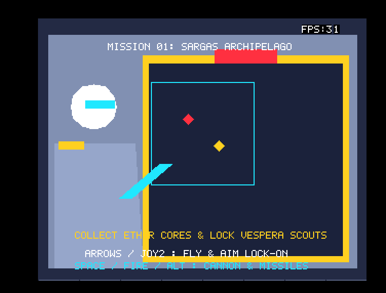
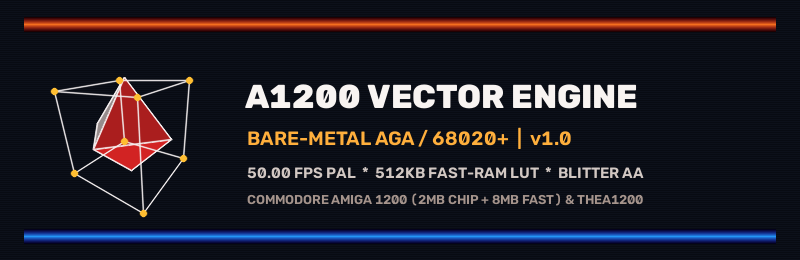

<p align="center"></p>

<p align="right"><strong>Polski</strong> | <a href="README_EN.md">English</a> | <a href="CHANGELOG.md">Changelog</a></p>

<div align="center">
  <h1>AETHER FALCON: VANGUARD v0.0.7</h1>
  <p><strong>Bare-metalowy symulator walki powietrznej 3D dla Commodore Amiga 1200 (M68020+ / AGA / 256 Colors) &amp; THEA1200</strong></p>
  <p>
    <a href="docs/">Pobierz .LHA</a> &bull;
    <a href="docs/">Pobierz FS-UAE .ZIP</a> &bull;
    <a href="CHANGELOG.md">Changelog</a>
  </p>
</div>

---

## Pobieranie (v0.0.7 — 2 Profile Sprzętowe)

| Obóz / Profil (`--profile`) | Platforma docelowa | Paczki do pobrania |
| :--- | :--- | :--- |
| **1. Standard `020` (`--profile standard`)** | Bazowa **Amiga 1200 (`68EC020`)** + Fast RAM — tryb **`320×128`** | [.LHA](docs/) · [.ZIP (FS-UAE/WinUAE)](docs/) |
| **2. THEA1200 (`--profile thea1200`)** | Konsola **THEA1200**, **Amiberry (PC)**, **FS-UAE** — pełny PAL **`320×256`** **16:9 Widescreen** (`-DFULL_RES -DWIDESCREEN_16_9`) | [.LHA](docs/) · [.ZIP (FS-UAE/WinUAE)](docs/) |

---

## Galeria (v0.0.7 — Amiga 1200 AGA / THEA1200)

|  |  |  |  |
|:---:|:---:|:---:|:---:|
| **1. Orientacja 3D 360° XF-14** | **2. Formacje Wrogów 360°** | **3. Boss Lewiatan 360° (Misja 03)** | **4. Game Over / Debriefing** |

## Wykorzystane Silniki i Powiązane Repozytoria

| Logo | Silnik i Repozytorium | Rola w projekcie |
| :---: | :--- | :--- |
| <a href="docs//malek69//aura3d-aga-engine"></a> | **[AURA-3D AGA Engine](docs//malek69//aura3d-aga-engine)** | Główny potok 3D (`STATE_GAMEPLAY`), teren wysokościowy (`terrain_3d.i`), myśliwiec **XF-14 Albatros** (`aura3d_v2.i`), C2P 256 kolorów (`c2p_chunky.i`), niebo Coppera (`copper_sky.i`), smugi (`particle_trail.i`), flary (`lens_flare.i`), sterowanie (`input_ctrl.i`), czcionka 5x7 (`hud_fps.i`) oraz audio `.MOD` (`pt_player.i`). |
| <a href="docs//malek69//amiga1200-vector-engine"></a> | **[Amiga 1200 Vector Engine](docs//malek69//amiga1200-vector-engine)** | Architektura ekranów taktyczno-wektorowych (**Intro**, **Briefing** z mapą sektora i **Debriefing** z oceną pilota w `src/af_campaigns.i`), zintegrowana ze wspólnym buforem 256 kolorów AGA. |
---

## Sterowanie

- **Strzałki Lewo / Prawo** lub **Joystick Port 2:** przechył (`Roll`) i skręt (`Yaw`) myśliwca **XF-14 Albatros**
- **Strzałki Góra / Dół** lub **Joystick Port 2:** wysokość lotu i ruch celownika **Lock-On** (`Pitch`)
- **Spacja / Enter / Fire / RMB:** start misji, odpalenie salwy rakiet **Lock-On** (do 8 celów) oraz dopalacz
- **H / L:** panel pomocy (`HELP`) oraz przełącznik języka HUD (`PL` / `EN`)
- **ESC / LMB:** wyjście do AmigaOS / WHDLoad

---

## Kompilacja ze Źródeł

```bash
python3 tools/build_game.py --profile all
```

Szczegółowy rejestr zmian znajduje się w pliku [CHANGELOG.md](CHANGELOG.md).

## Narzędzia Budowania i Generatory Zasobów (`tools/`)

| Skrypt | Rola w projekcie |
|:---|:---|
| `tools/build_game.py` | Główny skrypt kompilacji (`vasmm68k_mot`) i pakowania archiwów `.LHA` oraz paczek FS-UAE/WinUAE `.ZIP` dla profili `standard` i `thea1200`. |
| `tools/gen_aga_airbase_scenes.py` | Generator pełnoekranowych teł bazy lotniczej 256 kolorów AGA (`data/bg_airbase.bin`, `320×256`) oraz spriteów (`data/spr_moto.bin`) kwantyzowanych do palety `pal256.bin`. |
| `tools/gen_vanguard_mod.py` | Generator autorskiej 4-kanałowej ścieżki dźwiękowej ProTracker `.MOD` (`data/vanguard_anthem.mod`) wolnej od praw autorskich. |
