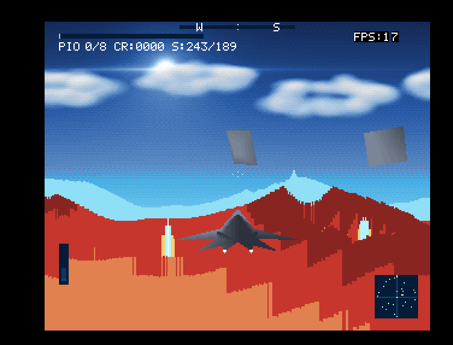
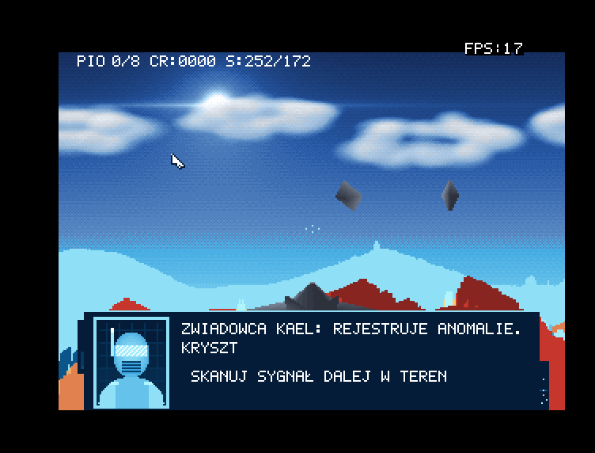
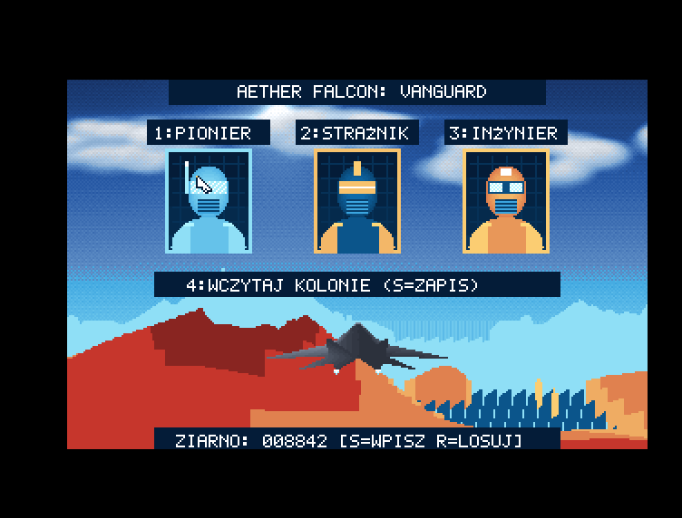
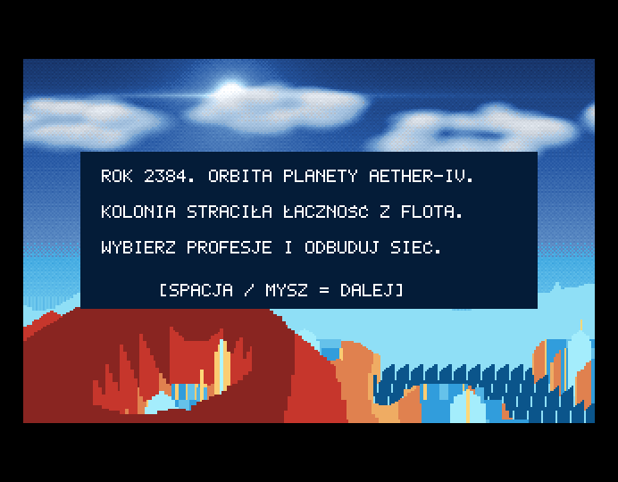

<strong>Polski</strong> | <a href="README_EN.md">English</a> | <a href="CHANGELOG.md">Changelog</a> | <a href="docs/archive/">Archiwum v0.1.x</a>

  <h1>AETHER FALCON: VANGUARD / EXOPLANET FRONTIER — v0.2.0.6</h1>
  
<strong>Dedykowany silnik 3D w asemblerze MC68040 dla konsoli THEA1200 (320×256 AGA / 256 kolorów)</strong>

---

> **Uwaga o restarcie projektu (`v0.1.x` → `v0.2.0.5`):** Poprzednia wersja `v0.1.x` (oparta na sztywnym trybie `68020` i połatanych modułach z dema) osiągnęła ścianę — nie dało się z niej wycisnąć oczekiwanej jakości ani stabilności, dlatego wyczyściliśmy kod i **zaczęliśmy od zera** pod jedną, docelową architekturę **THEA1200 (MC68040 + Fast RAM + AGA)**. Starsze pliki i zrzuty zostały przeniesione do [docs/archive/](docs/archive/).

---

## Pobieranie (`v0.2.0.6` — THEA1200)

| Profil (`--profile`) | Platforma docelowa | Paczki do pobrania |
| :--- | :--- | :--- |
| **THEA1200 Polski (`--profile thea1200_pl`)** | Konsola **THEA1200**, **Amiberry**, **FS-UAE** — pełna polska wersja z polskimi znakami AGA (`320×256`, `-m68040`) | [.LHA (WHDLoad)](docs/AetherFalcon_AGA_THEA1200_PL.lha) · [.ZIP (FS-UAE / WinUAE)](docs/AetherFalcon_AGA_THEA1200_PL_FSUAE.zip) |
| **THEA1200 English (`--profile thea1200_en`)** | **THEA1200**, **Amiberry**, **FS-UAE** — English edition (`320×256` AGA, 256 colors, `-m68040`) | [.LHA (WHDLoad)](docs/AetherFalcon_AGA_THEA1200_EN.lha) · [.ZIP (FS-UAE / WinUAE)](docs/AetherFalcon_AGA_THEA1200_EN_FSUAE.zip) |

---

## Platforma docelowa i inne konfiguracje sprzętowe

Obecna generacja projektu (`v0.2.x`) jest rozwijana **wyłącznie pod architekturę THEA1200 (`MC68040 + Fast RAM + AGA`, pełny PAL `320×256`, 256 kolorów)**.

- **Dlaczego tylko ta architektura:** silnik łączy pełnoekranowy teren **Voxel Space 3D 360°**, bryły **3D Gouraud**, 16-bitowy **Z-Buffer**, moduł filmowy (`letterbox`, portrety, 24-bitowy fader AGA) oraz 32-bitowy **C2P 68040**. Rezygnacja z bazowego procesora `68EC020` pozwala rozwijać pełnoprawną grę bez kompromisów w grafice i płynności.
- **Kompatybilne środowiska poza THEA1200:**
  - **Prawdziwa Amiga 1200 / Amiga 4000 (AGA)** z kartą turbo **`MC68040` lub `MC68060`** i pamięcią **Fast RAM** (uruchamiana z paczki `.LHA` przez WHDLoad).
  - **Amiberry**, **FS-UAE** oraz **WinUAE** skonfigurowane jako `A1200 + 68040 + Fast RAM + AGA` (gotowa paczka `_FSUAE.zip`).
- **Platformy niewspierane:** bazowa Amiga 1200 (`68EC020` bez Fast RAM), Amiga 500/600 (`OCS/ECS`) oraz okrojony tryb `320×128` z linii `v0.1.x` nie są już rozwijane (archiwalne wydania znajdują się w `docs/archive/`).

## Galeria `v0.2.0.6` (Szkielet Silnika 68040 THEA1200)

|  |  |  |  |
|:---:|:---:|:---:|
| **1. Lot 360°, kompas i radar** | **2. Dialog fabularny profesji** | **3. Wybór klasy i kursor** | **4. Prolog z letterboxem** |

## Co działa w `v0.2.0.6`
- **Silnik terenu Voxel Space 3D 360° (`MC68040`):** pełna rozdzielczość `320×256 AGA`, mgła odległości (`Z-Fog`) oraz bufor głębokości terenu (`vx_ybuf`).
- **Menu startowe i wybór kampanii (`src/exo_menu.i`):** Nowa Kampania z wyborem roli (**`1: PIONEER`**, **`2: GUARDIAN`**, **`3: ENGINEER`**) lub wczytanie zapisanej kolonii (**`4: LOAD SAVED COLONY`**).
- **Trwały zapis i odczyt na dysk (`src/exo_save_load.i`):** zapis stanu świata do `data/colony.sav` (auto-save przy aktywacji bazy oraz ręcznie pod klawiszem `S`).
- **HUD, radar i audio (`src/exo_ship_hud.i`, `src/exo_world_objs.i`, `src/exo_sound.i`, `src/exo_victory.i`):** minimapa `256×256`, pasek postępu, licznik `FPS`, ścieżka `.MOD` (`data/exo_theme.mod`) oraz efekty SFX na układzie Paula.

---

## Architektura Silników i Moduły (`MC68040` / AGA)

Projekt łączy dwa rozwijane silniki w czystym asemblerze **MC68040** zsynchronizowane w `refs/aura3d/engine/`:

| Moduł / Silnik | Pliki źródłowe | Rola w silniku |
| :--- | :--- | :--- |
| **Silnik Terenu Voxel Space 3D** | `src/aether_falcon.s`, `src/exo_menu.i, data/exo_voxel.bin, data/world_seed.bin` | Rzutowanie 360° w pełnym `320×256 AGA`, mgła odległości (`Z-Fog`) oraz 320-kolumnowy bufor głębokości (`vx_ybuf`). |
| **Silnik 3D Gouraud / EnvMap & Wektorowy** | `refs/aura3d/engine/aura3d_v2.i`, `vec3d_engine.i`, `src/exo_ship_hud.i` | Renderowanie bryły statku z przechyłem skrzydeł, cieniowaniem metalicznym i testem głębokości `zbuf_3d`. |
| **Potok Sprzętowy AGA & Audio Paula** | `gfx_engine.i`, `c2p_chunky.i`, `pt_player.i`, `src/exo_sound.i` | Przejęcie systemu AmigaOS, 8 bitplanów AGA (`256` kolorów), konwersja `c2p`, odtwarzacz `.MOD` oraz kanał SFX DMA. |
| **Rozgrywka, Menu Ról & Zapis na Dysk** | `src/exo_menu.i`, `exo_world_objs.i`, `exo_save_load.i`, `exo_victory.i` | Wybór specjalizacji (`1–3`), radar `256×256`, 3 profesje z portretami AGA, 3 statkami 3D, 3 utworami .MOD (mod_p1..3.mod), fabulami story_p1..3_pl.bin oraz zapis/odczyt `data/colony.sav` przez `dos.library`. |

---

## Narzędzia (`tools/`) i Budowanie Paczki THEA1200

| Skrypt w `tools/` | Zastosowanie i generowane zasoby |
|---|---|
| `tools/build_game.py` | Główny skrypt kompilacji (`--profile thea1200_pl`, `thea1200_en`, `thea1200`, `060`, `standard`) — buduje kod gry, slave WHDLoad oraz paczki `.lha` i `_FSUAE.zip`. |
| `tools/gen_open_world.py` | Generator otwartego świata z ziarna (`--seed 8842`) — wypala w `data/exo_voxel.bin` rzeźbę terenu, ocean, 8 baz (lądowiska, kopuły, wieże) i 8 kryształów Aetheru. |
| `tools/make_desktop_shortcuts.py` | Tworzy skróty uruchomieniowe na pulpicie Linuxa (`~/Pulpit/AetherFalcon_THEA1200.sh`) dla emulatora FS-UAE. |
| `tools/png_to_aga.py` | Konwerter grafik PNG na surowy format bitplanów / chunky 256-kolorowej palety AGA (`exo_pal256.bin`, portrety, niebo). |
| `tools/obj2amiga.py` / `mesh_conv.py` | Konwertery modeli 3D `.OBJ` na tablice wierzchołków, normalnych i trójkątów dla silnika Gouraud / EnvMap MC68040. |
| `tools/gen_phong_lut.py` / `gen_recip_table.py` | Generatory tablic look-up (`shade_lut`, odwrotności `1/z`) przyspieszających cieniowanie i rzutowanie 3D na procesorze MC68040. |
| `tools/build_cutscenes.py` / `pack_scenes.py` | Skrypty pakujące sekwencje przerywnikowe oraz sceny kampanii dla silnika filmowego (`cinematic_fx.i`). |
| `tools/build_demo.py` / `build_aura3d_demo.py` | Narzędzia do kompilacji samodzielnych dem technologicznych rdzenia `refs/aura3d/engine/`. |
| `tools/make_logo.py` / `make_showcase.py` | Skrypty generujące materiały graficzne, logotypy projektu i plansze prezentacyjne do `docs/`. |

- **Struktura katalogów:** `src/` (kod gry), `refs/aura3d/engine/` (rdzeń silników), `data/` (paleta AGA, mapa wysokości `exo_voxel.bin`, utwory `mod_p1..3.mod`, fabuły `story_p1..3_*.bin`, zapis `colony.sav`), `tools/` (skrypty budujące), `docs/archive/` (archiwalne wersje `v0.1.x`).

### Sterowanie (`THEA1200` / Klawiatura / Mysz / Pad)

- **Prolog, Menu i Epilog:** `Spacja` / `Enter` / `LMB` (przejście dalej), `1` (**Pionier**), `2` (**Strażnik**), `3` (**Inżynier**), `4` (**Wczytaj zapis kolonii** z `data/colony.sav`).
- **Sterowanie poduszkowcem 360°:** `W A S D` / `Strzałki` / `Mysz` / `Pad` (skręt 360° i pochylenie), `E` (zwiększenie ciągu), `Q` / `Z` / `C` (zmniejszenie ciągu), `X` (natychmiastowy zawis w miejscu `Throttle = 0`), `Spacja` / `Alt` (dopalacz).
- **Interakcja, Dziennik i System:** `F` / `R` / `LMB` / `Fire` (wiązka robocza / skaner / łączność z bazą), `J` / `L` / `Tab` (Dziennik Pokładowy i Mapa Topograficzna), `1`–`3` / `Enter` / `LMB` (wybór opcji w dialogach), `M` (oświetlenie atmosfery AGA), `F5` (zapis gry na dysk), `ESC` (wyjście do systemu).

### Aktualne wydanie: v0.2.0.6 (THEA1200 / Amiga 1200 AGA)
- **3 odrębne profesje i tryby gry:** Pionier (zwiad i skanowanie 8 kryształów Aetheru), Strażnik (patrol bojowy i neutralizacja 8 dronów), Inżynier (fizyczne dokowanie na lądowiskach i wznoszenie wież w 8 bazach kolonii).
- **Przepustnica i sterowanie:** 4-stopniowy ciąg (`E/Q/Z/C`), zawis (`X`), osobny dopalacz (`Spacja / LAlt`), wskaźnik `THR` na HUD oraz widoczny kursor strzałki sci-fi w menu.
- **Nawigacja open-world 360°:** górny kompas `N/W/S/E`, licznik pozycji `S:XXX/YYY`, obrotowy radar 360° ze strzałką celu profesji oraz Dziennik Pokładowy z mapą terenu pod `J`.

* Naprawiono 8-bajtowy format trójkątów siatki 3D (`[i0, i1, i2, tex_id]`) dla myśliwca i dronów.
* Wyrównano kąty macierzy obrotu `sin_tab` (`192`), sterowanie 360° (`game_input.i`) oraz prędkość lotu w menu i podczas misji.
* Dodano panoramiczne niebo 360° AGA (`exo_sky360.bin`) i portret oficera (`exo_portrait.bin`) w oknie dialogowym.
