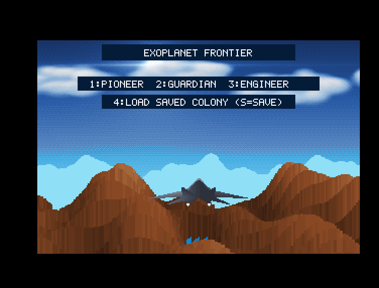
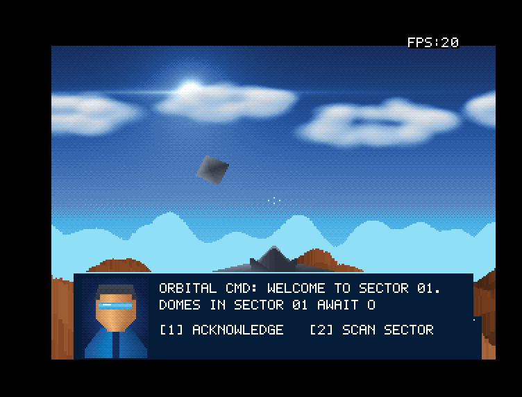

<strong>Polski</strong> | <a href="README_EN.md">English</a> | <a href="CHANGELOG.md">Changelog</a> | <a href="docs/archive/">Archiwum v0.1.x</a>

  <h1>AETHER FALCON: VANGUARD / EXOPLANET FRONTIER — v0.2.0.3</h1>
  
<strong>Dedykowany silnik 3D w asemblerze MC68040 dla konsoli THEA1200 (320×256 AGA / 256 kolorów)</strong>

---

> **Uwaga o restarcie projektu (`v0.1.x` → `v0.2.0.3`):** Poprzednia wersja `v0.1.x` (oparta na sztywnym trybie `68020` i połatanych modułach z dema) osiągnęła ścianę — nie dało się z niej wycisnąć oczekiwanej jakości ani stabilności, dlatego wyczyściliśmy kod i **zaczęliśmy od zera** pod jedną, docelową architekturę **THEA1200 (MC68040 + Fast RAM + AGA)**. Starsze pliki i zrzuty zostały przeniesione do [docs/archive/](docs/archive/).

---

## Pobieranie (`v0.2.0.3` — THEA1200)

| Profil (`--profile`) | Platforma docelowa | Paczki do pobrania |
| :--- | :--- | :--- |
| **THEA1200 (`--profile thea1200`)** | Konsola **THEA1200**, **Amiberry**, **FS-UAE** — pełny PAL **`320×256` AGA (256 kolorów)**, **`-m68040`** | [.LHA (WHDLoad)](docs/AetherFalcon_AGA_THEA1200.lha) · [.ZIP (FS-UAE / WinUAE)](docs/AetherFalcon_AGA_THEA1200_FSUAE.zip) |

---

## Platforma docelowa i inne konfiguracje sprzętowe

Obecna generacja projektu (`v0.2.x`) jest rozwijana **wyłącznie pod architekturę THEA1200 (`MC68040 + Fast RAM + AGA`, pełny PAL `320×256`, 256 kolorów)**.

- **Dlaczego tylko ta architektura:** silnik łączy pełnoekranowy teren **Voxel Space 3D 360°**, bryły **3D Gouraud**, 16-bitowy **Z-Buffer**, moduł filmowy (`letterbox`, portrety, 24-bitowy fader AGA) oraz 32-bitowy **C2P 68040**. Rezygnacja z bazowego procesora `68EC020` pozwala rozwijać pełnoprawną grę bez kompromisów w grafice i płynności.
- **Kompatybilne środowiska poza THEA1200:**
  - **Prawdziwa Amiga 1200 / Amiga 4000 (AGA)** z kartą turbo **`MC68040` lub `MC68060`** i pamięcią **Fast RAM** (uruchamiana z paczki `.LHA` przez WHDLoad).
  - **Amiberry**, **FS-UAE** oraz **WinUAE** skonfigurowane jako `A1200 + 68040 + Fast RAM + AGA` (gotowa paczka `_FSUAE.zip`).
- **Platformy niewspierane:** bazowa Amiga 1200 (`68EC020` bez Fast RAM), Amiga 500/600 (`OCS/ECS`) oraz okrojony tryb `320×128` z linii `v0.1.x` nie są już rozwijane (archiwalne wydania znajdują się w `docs/archive/`).

## Galeria `v0.2.0.3` (Szkielet Silnika 68040 THEA1200)

|  |  |  |
|:---:|:---:|:---:|
| **1. Menu startowe z letterboxem** | **2. Okno dialogowe z portretem** | **3. Lot 360° i odbicia wody** |

## Co działa w `v0.2.0.3` (obecny szkielet)
- **Silnik terenu Voxel Space 3D 360° (`MC68040`):** pełna rozdzielczość `320×256 AGA`, mgła odległości (`Z-Fog`) oraz bufor głębokości terenu (`vx_ybuf`).
- **Menu startowe i wybór kampanii (`src/exo_menu.i`):** Nowa Kampania z wyborem roli (**`1: PIONEER`**, **`2: GUARDIAN`**, **`3: ENGINEER`**) lub wczytanie zapisanej kolonii (**`4: LOAD SAVED COLONY`**).
- **Trwały zapis i odczyt na dysk (`src/exo_save_load.i`):** zapis stanu świata do `data/colony.sav` (auto-save przy aktywacji bazy oraz ręcznie pod klawiszem `S`).
- **HUD, radar i audio (`src/exo_ship_hud.i`, `src/exo_world_objs.i`, `src/exo_sound.i`, `src/exo_victory.i`):** minimapa `256×256`, pasek postępu, licznik `FPS`, ścieżka `.MOD` (`data/exo_theme.mod`) oraz efekty SFX na układzie Paula.

---

## Architektura Silników i Moduły (`MC68040` / AGA)

Projekt łączy dwa rozwijane silniki w czystym asemblerze **MC68040** zsynchronizowane w `refs/aura3d/engine/`:

| Moduł / Silnik | Pliki źródłowe | Rola w silniku |
| :--- | :--- | :--- |
| **Silnik Terenu Voxel Space 3D** | `src/aether_falcon.s`, `data/exo_voxel.bin` | Rzutowanie 360° w pełnym `320×256 AGA`, mgła odległości (`Z-Fog`) oraz 320-kolumnowy bufor głębokości (`vx_ybuf`). |
| **Silnik 3D Gouraud / EnvMap & Wektorowy** | `refs/aura3d/engine/aura3d_v2.i`, `vec3d_engine.i`, `src/exo_ship_hud.i` | Renderowanie bryły statku z przechyłem skrzydeł, cieniowaniem metalicznym i testem głębokości `zbuf_3d`. |
| **Potok Sprzętowy AGA & Audio Paula** | `gfx_engine.i`, `c2p_chunky.i`, `pt_player.i`, `src/exo_sound.i` | Przejęcie systemu AmigaOS, 8 bitplanów AGA (`256` kolorów), konwersja `c2p`, odtwarzacz `.MOD` oraz kanał SFX DMA. |
| **Rozgrywka, Menu Ról & Zapis na Dysk** | `src/exo_menu.i`, `exo_world_objs.i`, `exo_save_load.i`, `exo_victory.i` | Wybór specjalizacji (`1–3`), radar `256×256`, aktywacja baz wiązką oraz zapis/odczyt `data/colony.sav` przez `dos.library`. |

---

## Narzędzia (`tools/`) i Budowanie Paczki THEA1200

- **`tools/build_game.py --profile thea1200`:** automatycznie kompiluje kod główny oraz slave WHDLoad (`vasmm68k_mot -m68040 -DFULL_RES -DWIDESCREEN_16_9`), pakuje archiwum **WHDLoad (`.lha`)** oraz gotowy dysk pod **FS-UAE (`.zip`)**.
- **Struktura katalogów:** `src/` (kod gry), `refs/aura3d/engine/` (rdzeń silników), `data/` (paleta AGA, mapa wysokości, `.MOD`, zapis `colony.sav`), `tools/` (skrypty budujące), `docs/archive/` (archiwalne wersje `v0.1.x`).

### Sterowanie (`THEA1200` / Klawiatura / Joystick)
- **Menu startowe:** `1` (`PIONEER`), `2` (`GUARDIAN`), `3` (`ENGINEER`) — Nowa Kampania; `4` — Wczytaj zapisaną kolonię (`data/colony.sav`).
- **Lot 360°:** `Strzałki` / `Joystick` (obrót 360° i wysokość), `Spacja` / `Fire` (aktywacja bazy wiązką / dopalacz), `S` (zapis stanu gry na dysk), `ESC` / `LPM` (wyjście do systemu).

### Aktualne wydanie: v0.2.0.3 (THEA1200 / Amiga 1200 AGA)

* Naprawiono 8-bajtowy format trójkątów siatki 3D (`[i0, i1, i2, tex_id]`) dla myśliwca i dronów.
* Wyrównano kąty macierzy obrotu `sin_tab` (`192`), sterowanie 360° (`game_input.i`) oraz prędkość lotu w menu i podczas misji.
* Dodano panoramiczne niebo 360° AGA (`exo_sky360.bin`) i portret oficera (`exo_portrait.bin`) w oknie dialogowym.

### Zrzuty ekranu (v0.2.0.3 — FS-UAE / THEA1200)

