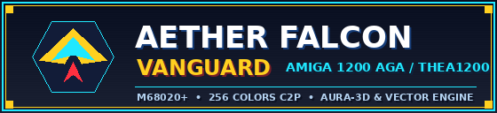
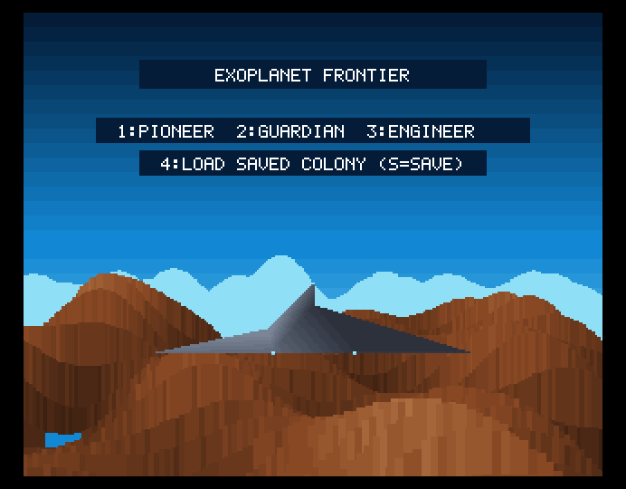
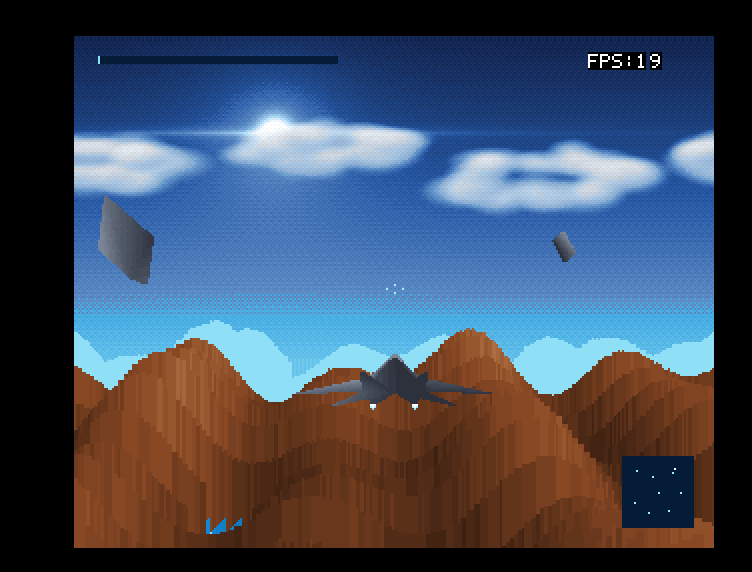

<a href="README.md">Polski</a> | <strong>English</strong> | <a href="CHANGELOG_EN.md">Changelog</a> | <a href="docs/archive/">Archive v0.1.x</a>

# AETHER FALCON: VANGUARD / EXOPLANET FRONTIER — v0.2.0.2

**Dedicated MC68040 Assembly 3D Engine for THEA1200 (320×256 AGA / 256 Colors)**

> **Project Reboot Note (`v0.1.x` → `v0.2.0.2`):** The previous `v0.1.x` build (based on a rigid 68020 demo setup) hit an architectural ceiling. We started fresh from the ground up targeting **THEA1200 (MC68040 + Fast RAM + AGA)** with a clean, modular engine. Legacy files and screenshots were moved to `docs/archive/`.

## Downloads (`v0.2.0.2` — THEA1200)

| Profile (`--profile`) | Target Hardware | Download Packages |
|---|---|---|
| **THEA1200 (`--profile thea1200`)** | **THEA1200**, **Amiberry**, **FS-UAE** — native PAL **320×256 AGA (256 colors)**, `-m68040` | [.LHA (WHDLoad)](docs/AetherFalcon_AGA_THEA1200.lha) · [.ZIP (FS-UAE / WinUAE)](docs/AetherFalcon_AGA_THEA1200_FSUAE.zip) |

## Gallery `v0.2.0.2` (Frozen 68040 THEA1200 Engine)

|  |  |  |
|:---:|:---:|:---:|
| **1. Start Menu with Cinema Letterbox** | **2. Dialogue Box with Animated Portrait** | **3. 360° Flight with Water Reflections & 3D Meshes** |

## Frozen Engine Capabilities (`v0.2.0.2`)

- **360° Voxel Space 3D Terrain (`src/terrain_3d.i`):** incremental `MC68040` raymarching (zero `muls.w` in the inner ray loop), `vx_row_lut` row LUT, dynamic horizon pitch (`cam_pitch`), 320-column depth buffer (`vx_ybuf`), animated water reflections, distance fog (`Z-Fog`), and biosphere palette shift.
- **Gouraud 3D Meshes, Shadows & Particles (`src/vec3d_engine.i`, `refs/aura3d/engine/aura3d_v2.i`):** 3D polygon rendering with `movem.l` Z-buffer clear, terrain-projected shadows underneath 3D objects, 360° sun with atmospheric corona, 360° clouds, 32-slot 3D particle system, and Bresenham 2D lines.
- **Cinematic & Narrative Engine (`src/cinematic_fx.i`):** smooth letterbox bars (open/retract), dialogue box with typewriter effect and animated portrait, plus smooth camera choreographer.
- **THEA1200 Hardware & 32-Bit AGA Pipeline (`src/thea1200_hw.i`, `src/c2p_chunky.i`, `src/exo_save_load.i`, `src/exo_sound.i`):** 32-bit `68040` Chunky-to-Planar (`320×256 AGA`), 24-bit 8-bank AGA palette fader & mood lighting, hot-swap peripherals (`Keyboard / Mouse $DFF00A / Gamepad $DFF016`), persistent disk save/load (`data/colony.sav`), and Paula `.MOD` + DMA SFX.

## Engine Modules (`MC68040` / `AGA`)

All engine modules are compiled with **0 errors and 0 warnings** (`vasmm68k_mot -m68040`) and synced across `src/` and `refs/aura3d/engine/`:

| Module | Source Files | Responsibility |
|---|---|---|
| **Voxel Space 3D Terrain** | `src/terrain_3d.i`, `data/exo_voxel.bin` | 360° terrain projection (`320×256 AGA`), water reflections, `Z-Fog`, and `vx_ybuf` depth buffer. |
| **3D Gouraud & FX Rasterizer** | `src/vec3d_engine.i`, `refs/aura3d/engine/aura3d_v2.i` | 3D ship, drones & colony domes with Gouraud shading, `zbuf_3d`, ground shadows, sun corona, clouds, and 3D particles. |
| **Cinematic & Dialogue Engine** | `src/cinematic_fx.i` | Cinema letterbox bars, animated portrait renderer, typewriter dialogue panel, and camera interpolation. |
| **Flight Controller & Peripherals** | `src/flight_ctrl.i`, `src/thea1200_hw.i`, `input_ctrl.i` | 360° flight with wing bank, horizon pitch, ground collision floor, 24-bit AGA fader/tint, and mouse/gamepad/keyboard input. |
| **AGA C2P, Disk Save & Audio** | `src/c2p_chunky.i`, `gfx_engine.i`, `exo_save_load.i`, `exo_sound.i` | AmigaOS takeover, 32-bit 68040 C2P (`8 bitplanes`), `data/colony.sav` persistence, `.MOD` playback, and Paula SFX. |

## Build Tools (`tools/`) & Controls

- **Build Command:** `python3 tools/build_game.py --profile thea1200` compiles the main executable and WHDLoad slave, generating `.lha` and `.zip` packages.
- **Start Menu:** `1` (**PIONEER**), `2` (**GUARDIAN**), `3` (**ENGINEER**) or left-click with the mouse; `4` — Load saved colony (`data/colony.sav`).
- **360° Flight & Dialogues:** **Mouse** / **Arrow Keys** / **Joystick** (360° turn, wing bank & altitude), **Space / Fire** (beam / boost), **`1`–`3` / LMB** (dialogue choices), **`E`** (AGA 24-bit mood lighting test), **`S`** (save game), **`ESC`** (quit to OS).
