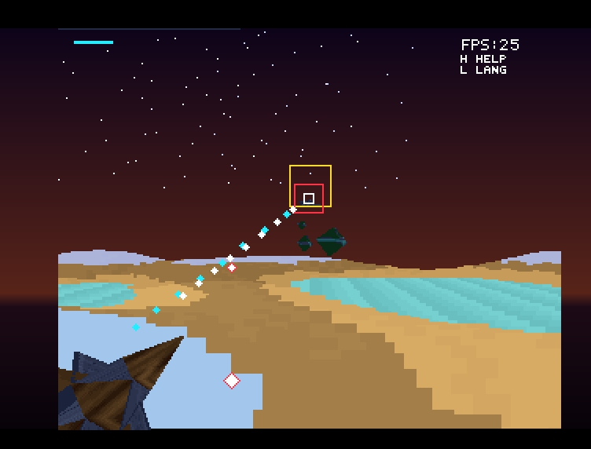

<p align="center"></p>

<p align="right"><a href="README.md">Polski</a> | <strong>English</strong> | <a href="CHANGELOG_EN.md">Changelog</a></p>

<div align="center">
  <h1>AETHER FALCON: VANGUARD v0.1.3.1</h1>
  <p><strong>Bare-metal 3D combat flight simulator for Commodore Amiga 1200 (M68020+ / AGA / 256 Colors) &amp; THEA1200</strong></p>
  <p>
    <a href="docs/">Download .LHA</a> &bull;
    <a href="docs/">Download FS-UAE .ZIP</a> &bull;
    <a href="CHANGELOG_EN.md">Changelog</a>
  </p>
</div>

---

## Downloads (v0.1.3.1 — 2 Hardware Profiles)

| Profile (`--profile`) | Target Platform | Download Packages |
| :--- | :--- | :--- |
| **1. Standard `020` (`--profile standard`)** | Stock **Amiga 1200 (`68EC020`)** + Fast RAM — **`320×128`** mode | [.LHA](docs/) · [.ZIP (FS-UAE/WinUAE)](docs/) |
| **2. THEA1200 (`--profile thea1200`)** | **THEA1200**, **Amiberry (PC)**, **FS-UAE** — full PAL **`320×256`** **16:9 Widescreen** (`-DFULL_RES -DWIDESCREEN_16_9`) | [.LHA](docs/) · [.ZIP (FS-UAE/WinUAE)](docs/) |
| **3. Turbo 060 (`--profile 060`)** | **Amiga 1200 + Blizzard/Apollo 1260** (`MC68060`) — Full PAL **320×256** **16:9** (`-m68060 -DM68060`) | [.LHA](https://github.com/malek69/aether-falcon-vanguard/releases/download/v0.1.3.1/AetherFalcon_AGA_060.lha) · [.ZIP](https://github.com/malek69/aether-falcon-vanguard/releases/download/v0.1.3.1/AetherFalcon_AGA_060_FSUAE.zip) |

---

## Gameplay & 3D Engine Video (v0.1.3.1)

[](https://github.com/malek69/aether-falcon-vanguard/releases/download/v0.1.3.1/demo_silnik.mp4)

**[▶ Click to watch / download 3D Gameplay & Engine Video (H.264 MP4, 1080p)](https://github.com/malek69/aether-falcon-vanguard/releases/download/v0.1.3.1/demo_silnik.mp4)**

## Rotoscoped *Eon* (TBL) Vector Engine Cinematics Gallery (v0.1.3.1)

|  |  |  |
|:---:|:---:|:---:|
| **1. Act I: Salute to the Sky** | **2. Act II: Solis Airbase (Eon Style)** | **3. Act III: XF-14 Cockpit** |
|  |  |  |
|:---:|:---:|:---:|
| **4. Act IV: 3D XF-14 Launch** | **5. Briefing: Squadron Commander** | **6. Debriefing: 3/4 Pilot Portrait** |

## Gallery v0.1.3.1 — Tactical Briefing Board, 3D Clouds & Live SCORE HUD

|  |  |
|:---:|:---:|
| **1. Tactical Mission Briefing Board** | **2. Volumetric 3D Clouds, Voxels & SCORE: 002350** |

## 3D Voxel Terrain Gallery (v0.1.3.1 — Amiga 1200 AGA / THEA1200)

|  |  |  |
|:---:|:---:|:---:|
| **1. Voxel Ocean & Islands** | **2. 360° Flight & 3D Lock-On** | **3. Voxel Mountains, Land & 3D Meshes** |

## Gallery (v0.0.7 — 360° Mechanics & Game Over)

|  |  |  |  |
|:---:|:---:|:---:|:---:|
| **1. Intro: 256-col Airbase & Pilot** | **2. Intro: Cockpit Boarding** | **3. Briefing & Tactical Notepad** | **4. 3D 360° Circular Orbit** |

## Engines Used & Related Repositories

| Logo | Engine & Repository | Role in Project |
| :---: | :--- | :--- |
| <a href="https://github.com/malek69/aura3d-aga-engine"></a> | **[AURA-3D AGA Engine](https://github.com/malek69/aura3d-aga-engine)** | Core 3D gameplay pipeline (`STATE_GAMEPLAY`), heightmap terrain (`terrain_3d.i`), **XF-14 Albatros** fighter (`aura3d_v2.i`), 256-color C2P (`c2p_chunky.i`), Copper sky (`copper_sky.i`), trails (`particle_trail.i`), lens flare (`lens_flare.i`), controls (`input_ctrl.i`), 5x7 font (`hud_fps.i`), and `.MOD` player (`pt_player.i`). |
| <a href="https://github.com/malek69/amiga1200-vector-engine"></a> | **[Amiga 1200 Vector Engine](https://github.com/malek69/amiga1200-vector-engine)** | Tactical vector screen architecture (**Intro**, **Briefing** sector map, and **Debriefing** pilot rank evaluation in `src/af_campaigns.i`), unified into the 256-color AGA framebuffer. |
---

## Story & 3-Mission Campaign

As an ace pilot of the **Vanguard** wing, you launch your **XF-14 Albatros** interceptor from the airfield base **Solis** to repel the **Vespera Dominion** invasion:

1. **Mission 01 — Sargas Archipelago:** Patrol over the archipelago, harvesting scattered **Ether Cores** and intercepting Vespera scout squadrons flying in 360° spiral formations.
2. **Mission 02 — Krell Storm Canyon:** High-speed run through Krell Storm Canyon against double-helix 360° enemy waves requiring *Multi-Lock* missile salvos.
3. **Mission 03 — Leviathan Citadel:** Final assault on the **Leviathan Flying Fortress** 3D flagship hovering at the tunnel center, powered by **4 orbiting core reactors**.

---

## 3D Space Objects — Shoot vs. Collect

| 3D Object | Appearance & Behavior | Pilot Action |
| :--- | :--- | :--- |
| **Vespera Interceptors** | Dark angular 3D fighters flying nose-first toward you; automatically targeted by the **Lock-On** reticle. | **Destroy** using twin wingtip plasma cannons and *Multi-Lock* homing missiles. |
| **Ether Cores** | Rotating cyan-turquoise 3D octahedron crystals floating in the corridor. | **Do NOT shoot — collect!** Flying close absorbs the core, restoring **+40 shield energy** and awarding **+250 pts**. |
| **Enemy Plasma Bolts** | Red-white energy bolts fired from deep inside the tunnel past your ship off-screen. | **Evade** around the 360° circle — each hit drains **25 shield energy** (`SHIELD HIT!`). |
| **Leviathan Boss & 4 Reactors (Mission 03)** | Multi-hull 3D citadel at screen center surrounded by **4 orbiting crystal reactors** firing radial barrages. | **Lock onto and destroy all 4 reactors** (2 hits each) to win the campaign. |

---

## Controls (360° Cylindrical Flight)

- **Left / Right Arrows** or **Joystick Port 2:** fly around the full **360°** circle (nose always aimed at screen center, belly outward, wings tangent to the orbit)
- **Up / Down Arrows** or **Joystick Port 2:** move inward toward center (Up) or outward toward screen edge (Down) without pitching the hull
- **Space / Enter / Fire / RMB:** launch mission, fire twin plasma cannons, release **Multi-Lock** missile salvos, and engage afterburner
- **H / L:** toggle in-flight Help overlay (`HELP`) and HUD language (`PL` / `EN`)
- **ESC / LMB:** save high score (`hiscore.dat`) and exit to AmigaOS / WHDLoad

---

## Building from Source

```bash
python3 tools/build_game.py --profile all
```

See [CHANGELOG_EN.md](CHANGELOG_EN.md) for the complete version history.

## Build Tools & Asset Generators (`tools/`)

| Script | Role in the Project |
|:---|:---|
| `tools/build_game.py` | Master build pipeline (`vasmm68k_mot`) packaging `.LHA` and FS-UAE/WinUAE `.ZIP` archives for `standard` and `thea1200` profiles. |
| `tools/gen_aga_airbase_scenes.py` | Generator of full-screen 256-color AGA sunset airbase backdrops (`data/bg_airbase.bin`, `320×256`) and transparent sprites (`data/spr_moto.bin`) quantized to `pal256.bin`. |
| `tools/gen_vanguard_mod.py` | Procedural 4-channel ProTracker `.MOD` soundtrack generator (`data/vanguard_anthem.mod`) with royalty-free synth & drum samples. |

---

## Graphics Engine Capabilities (AURA-3D AGA + Vector Engine)

- **Real-Time 3D Rasterizer (M68020+):** **Gouraud** and **Environment Mapping** shading with a 16-bit **Z-Buffer**, texture support, and automatic near-plane clipping.
- **Native 256-Color AGA & C2P:** fast *Chunky-to-Planar* pipeline (`320×128` for stock Amiga 1200 and full PAL `320×256` **16:9 Widescreen** for THEA1200/FS-UAE) paired with a dynamic **Copper** sky gradient.
- **3D Terrain & Particle FX:** procedural 3D canyon corridor, twin engine exhaust trails, 3D lens flare, planar shadows, and multi-particle 3D explosions.
- **Hybrid Vector-Polygon Pipeline:** fast `16.16` fixed-point N-gon polygon rasterizer for story screens (**Intro**, **Briefing**, **Debriefing / Game Over**) sharing the 256-color AGA framebuffer and 4-channel **Paula** audio (`.MOD` + `SFX`).
- **Multi-Tone Rotoscoped *Eon* (The Black Lotus) Story Scenes (`src/af_vector_scenes.i`):** borderless multi-faceted polygon scene player `af_play_eon_scene` for **Intro** (pilot silhouette raising a fist against a silver sky), **Briefing** (Commander portrait beside the mission briefing board), and **Debriefing / Game Over** (3/4 side-lit pilot portrait).
- **Volumetric 3D Clouds, Ground Shadows & Live Score HUD (`src/af_voxel_world.i`, `src/af_gameplay_3d.i`):** 16 mission-adaptive 3D cloud formations, active `Phong + Z-Fog` shaders, real-time XF-14 ground shadow, plus live **`SCORE: 000000`** and **`M1/3`** mission counter in the top-left HUD.
- **Disk Asset Streaming & Persistent Save (`dos.library` / `src/af_disk_loader.i`):** dynamically loads external assets from `data/` (`missions.dat`, 256-color backdrops `bg_airbase.bin`, `title.chk`/`title.pal`, transparent sprites `spr_moto.bin`, soundtrack `vanguard_anthem.mod`, and `intro.pcm` samples) into Fast/Chip RAM before hardware takeover, and writes persistent high scores (`data/hiscore.dat`) upon exit.

## Converting 3D Models from Wavefront `.OBJ` Files

The toolchain includes ready-to-use converters for turning any `.OBJ` 3D model into M68k assembly meshes:

```bash
python3 tools/mesh_conv.py --obj assets_raw/vespera_interceptor.obj --out src/custom_mesh.i --prefix custom --radius 42 --tex 0
```

## Complete Toolchain Reference (`tools/`)

The `tools/` directory includes the complete 15-script toolchain (`mesh_conv.py`, `obj2amiga.py`, `build_game.py`, `png_to_aga.py`, LUT/table generators, and audio/scene packers) supporting the Amiga 1200 vector engine.

## Video / YouTube to PCM & Vector Stream Converter (`tools/`)

The `tools/` directory includes the complete toolchain from both integrated engines (**AURA-3D AGA Engine** and **Amiga 1200 Vector Stream Engine**), including a video converter (e.g. YouTube clips via `yt-dlp` / `ffmpeg`) producing 8-bit signed PCM audio and N-gon vector polygon streams:

```bash
python3 tools/build_demo.py --video input.mp4 --fps 50 --threshold 128 --crop-43
```

## Complete Developer Toolchain Reference (`tools/` — 16 Scripts)

| Script | Engine / Origin | Role & Capabilities |
| :--- | :--- | :--- |
| `tools/build_game.py` | **Aether Falcon** | Master build pipeline (`vasmm68k_mot`) packaging `.LHA` and `_FSUAE.zip` archives for `standard` (`68EC020` `320x128`) and `thea1200` (`320x256` 16:9). |
| `tools/build_demo.py` | **Vector Engine** | Universal video-to-vector converter generating closed N-gon streams (`scene_data.i` with XOR LUT cutouts) and 8-bit signed PCM audio for Paula DMA (`--video`, `--fps`, `--threshold`, `--crop-43`, `--thin-lines`). |
| `tools/build_median.py` | **Vector Engine** | Dedicated 50 FPS video pipeline (`624x496` -> `320x256` AGA + Blitter AA, dual color layer separation, polygon simplification, `.LHA` / `.ZIP` packaging). |
| `tools/profile_patch.py` | **Vector Engine** | Patcher for AGA Hi-Res (`640x256`) and Interlace (`640x512`) vector engine display modes. |
| `tools/mesh_conv.py` | **AURA-3D** | Wavefront `.OBJ` to M68k vertex, normal, and triangle table converter (Vespera Interceptors, Ether Cores, Leviathan Boss). |
| `tools/obj2amiga.py` | **AURA-3D** | Alternative `.OBJ` mesh parser with scale normalization and multi-material support. |
| `tools/png_to_aga.py` | **AURA-3D** | Converts `.PNG` images into `64x64` chunky textures (`--mode texture`) or full-screen `320x256` 8-bitplane AGA screens + 24-bit palettes (`--mode bitplanes`). |
| `tools/gen_aga_airbase_scenes.py` | **Aether Falcon** | Generates full-screen 256-color AGA sunset airbase backdrops (`data/bg_airbase.bin`, `320x256`) and transparent sprites (`data/spr_moto.bin`). |
| `tools/gen_topgun_mod.py` | **Aether Falcon** | Procedural 4-channel ProTracker `.MOD` soundtrack generator (`data/vanguard_anthem.mod`) with royalty-free synth & drum samples. |
| `tools/fetch_mod.py` | **AURA-3D** | Helper script to download and verify external ProTracker `.MOD` music modules. |
| `tools/gen_phong_lut.py` | **AURA-3D** | Generates the `phong_norm_lut.bin` lookup table for Phong normal mapping and *Fresnel Rim Glow*. |
| `tools/gen_recip_table.py` | **AURA-3D** | Generates the 32-bit reciprocal table `recip_table_32.bin` (`1/Z` in `16.16` fixed-point for division-free projection). |
| `tools/pack_scenes.py` | **AURA-3D** | Packs scene assets and binary resources into consolidated `.PAK` archives. |
| `tools/make_logo.py` | **AURA-3D** | Generates bitplane AGA logos and title headers from source artwork. |
| `tools/make_showcase.py` | **AURA-3D** | Composes visual showcase sheets and engine feature previews. |
| `tools/build_aura3d_demo.py` | **AURA-3D** | Master builder for the 8-scene **AURA-3D AGA Engine** showcase demo (`.ADF`, `.LHA`, `_FSUAE.zip`). |

## Complete Engine Module Overview (`src/` & `refs/`)

- **3D Voxel Space Terrain Engine (`src/af_voxel_world.i`):** column-based Voxel Space raycaster (with horizon Y-buffer) rendering ocean waves, islands, and mountains (Mission 01), deep canyon cliffs & river (Mission 02), and volcanic terrain with citadel towers (Mission 03).
- **3D Gouraud / EnvMap Pipeline (`refs/aura3d/engine/aura3d_v2.i`):** Gouraud + Environment Mapping with M68020+ `bfextu` optimization, 16-bit Z-Buffer, specular highlights, up to 4 `64x64` textures per mesh, and `1/Z` reciprocal tables.
- **Additional 3D Effects in `refs/aura3d/engine/`:** Phong normal mapping + *Fresnel Rim Glow* (`phong_norm_lut.bin`), sinusoidal water plane (`ground_grid.i`), 3D water mirror reflections (`mirror_reflect.i`), planar shadows (`planar_shadow.i`), 3D lens flare (`lens_flare.i`), depth `Z-Fog`, 3D vertex morphing (`morph_target.i`), and 3D particle trails (`particle_trail.i`).
- **Vector Stream & PCM Engine (`refs/vector/src/`):** compressed N-gon polygon stream decoder with interior cutout support (`scene_player.i` + `vec3d_engine.i`, 512 KB XOR `fill_lut` in Fast RAM), streaming 8-bit signed PCM audio player (`audio_player.i`, 4-channel Paula DMA IRQ Level 4 with LED filter disabled), and AGA Hi-Res `640x256` / Interlace `640x512` modes.
